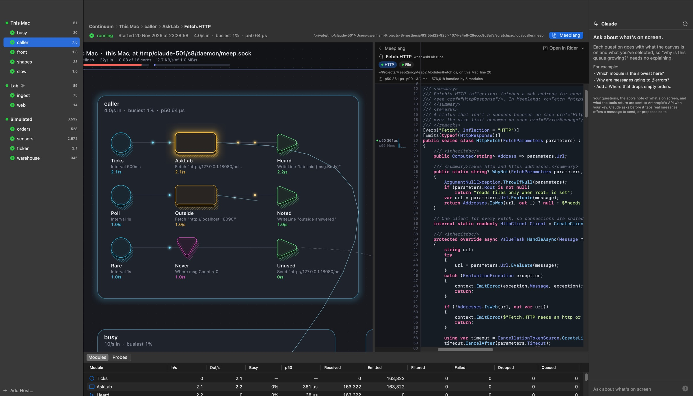
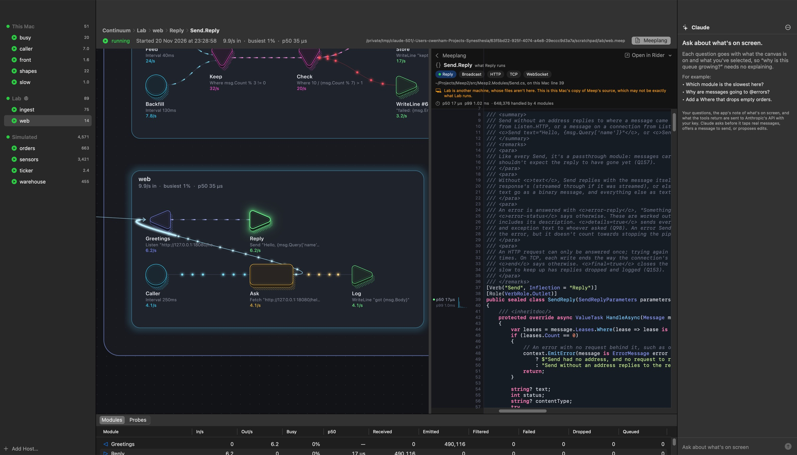

# Step 10: the code level

Written 21 November 2026. The tenth step of the order of work in [architecture-round-1.md](architecture-round-1.md), section 11: level 1 of the zoom ladder (section 2), "the C# of the inflections behind a verb, with each one's handling time in the gutter", which you can read and open in Rider or VS Code. Editing and rebuilding come later. It uses `meep lsp`'s verb catalogue with its source locations (Meep2 2ef2d35) and the subscription's handling-time histograms (Meep2 0c83a49), and needed nothing new from Meep2 to work on this Mac. For a module on another host it adds prompt 9 to [meep2-prompts.md](meep2-prompts.md). Nothing is committed.

## What's built

- **Getting there,** from a module, in four ways:
  - **Its inspector:** the verb beside the module's name (`Fetch.HTTP {}`) is a button.
  - **Its menu** on the canvas: Show C# of Fetch.HTTP.
  - **The Meeplang text:** ⌘-clicking a verb or inflection, as the design asks, with the pointing hand while ⌘ is down; and Show C# of Fetch.HTTP at the top of the text's menu.
  - **Claude:** `show` with `code`.
- **Where it shows:** in the Meeplang's place beside the canvas, which stays open behind it.
  - **The breadcrumb** goes on below the pipeline: Continuum › This Mac › orders › Prices › Fetch.HTTP.
  - **Back:** the Meeplang button, or ⎋ in the code. Show in Text and choosing another pipeline go back too.
- **Every inflection of the verb,** as chips under its name. The one the module resolves to comes first, marked with a green dot, and shows first; a module whose parameters fit more than one has each marked.
- **Where the C# comes from** (`SourceLibrary`, in `CodeEditing`), in the catalogue's order:
  - **The file,** when it's on this Mac.
  - **Otherwise the SourceLink address,** read over HTTPS with an ephemeral session and kept in `~/Library/Caches/Synesthesia/SourceLink` by a hash of the address. The address is pinned to a commit, so what's kept never goes stale.
    - **Once:** inflections sharing a file (Send's five are all in `Send.cs`) ask for it once, even at the same time.
    - **Only https,** at most 8 MB, as UTF-8 text.
  - **Otherwise a plain note** saying why, such as:
    - a plugin without its PDB;
    - a file not on this Mac with no SourceLink;
    - GitHub couldn't be reached, or answered 404 (with Try Again);
    - a plugin on another host that this Mac hasn't got;
    - a verb this Mac's Meep doesn't know.
  - **The header says which:** "~/Projects/Meep2/src/Meep2.Modules/Fetch.cs, on this Mac", or "GitHub at 810c2fc, from its SourceLink (kept on this Mac)", with the whole path or address on hover.
- **A module on another host** is shown this Mac's copy of Meep's source, with a note saying it may not be exactly what that host runs: nothing from Meep2 says what another host runs (prompt 9).
- **The view** (`MacSourceText`, in `SynesthesiaMac`): read-only TextKit 2, selectable and searchable (⌘F), in the Meeplang's font and palette.
  - **Its class revealed:** scrolled so the class's documentation and attributes are at the top, the declaration flashed, and its lines lit faintly so it stands out among the file's other classes. "line 19" in the header reveals it again.
  - **A file changed since Meep was built:** the PDB's line may no longer declare the class (`Fetch.cs` had moved `HttpFetch` down a line while this was built). The class is then found by name, nearest that line.
- **Highlighting, in Swift** (`CSharpText`, in `CodeEditing`): a small lexer, not a parser, with no C# language server, as the step asks.
  - **Coloured:** keywords, types, methods, attributes, strings of every kind (verbatim, interpolated with their holes, raw), characters, numbers, comments and directives, in the canvas's palette.
  - **Each class's lines,** found from its braces, skipping those in strings and comments: the gutter, the lit lines and the tool use them.
- **The gutter:** line numbers, and at each inflection's class in the file:
  - **The figures:** p50 on the class's line, p99 on the next, and a small histogram of the buckets beside them, the median's bar brighter.
  - **Merged** across every module in the Continuum that runs the inflection, on every host.
  - **The whole figures on hover,** as your notes ask: how many handled, the median, 99th percentile, mean, fastest and slowest, then each module's median and 99th percentile by its label, pipeline and host.
  - **A file holding several inflections** has a set at each: `Send.cs` shows all five of Send's.
  - **Refreshed** once a second, as level 2's gutter is.
- **The header's times:** the shown inflection's p50 and p99, and how many messages from how many modules, with the same whole figures on hover.
- **Asking for times only while the code shows** (`CodeLevel.startAskingForTimes`), through the planner:
  - **The ask:** a pipeline keeps asks by whoever asked (`MeepPipeline.askForTiming(of:by:)`), and `timingWanted` is what they add up to.
  - **The planner** (`SubscriptionPlanner.rates(for:flows:timing:…)`) gives a pipeline with asked-for modules their histograms at the rate a pipeline in focus has them (every 2 seconds), with its totals, however little of it the canvas shows, and slows them with everything else to stay within the host's budget.
  - **The plan** names just those modules' keys under `timing` for that pipeline, or `*` when it's in focus anyway.
  - **Kept up to date:** the code level looks once a second for modules that now run its inflections, and takes its asks away when it's hidden.
- **Opening it in your editor:**
  - **Found:** Rider, VS Code and VS Code Insiders, by bundle identifier. Both Rider and VS Code are on this Mac.
  - **Opened at the class's line:** Rider as JetBrains' command line does on the Mac (`open -na Rider.app --args --line 19 <file>`, which hands the file to the Rider already running), and VS Code by its `vscode://file/<path>:19:1` address.
  - **Remembered:** the button opens in the editor chosen last, with the others in its menu, and the choice is in Settings › Code.
  - **No file on this Mac:** the button opens the SourceLink's page on GitHub, at the commit and line (`github.com/…/blob/810c2fc…/Fetch.cs#L19`), rather than the raw text the address gives.
- **MCP and the sidebar**, written once in `Assistant`:
  - **`read_inflection_source`** (new): the inflection a module runs, or one named (`Fetch.HTTP`).
    - **What it gives:** where its C# came from, its class with its documentation and attributes and line numbers (or the whole file with `whole`), the handling times of every module running it, merged and each module's, and the verb's other inflections with where each is.
    - **Times:** when none have come, it asks the hosts for them and waits up to 4 seconds, then stops asking.
    - **A verb with several inflections, none named:** the list, to choose from.
  - **`describe_view`:** with the C# showing, says which inflection and module, where it came from, its class's lines, the lines on screen and the times, in place of the text's description.
  - **`show`:** `code` opens a module's C# as well as showing the module.
  - **The sidebar's note** says when the C# shows, and whose.
- **`meep/verbs`' `plugin`** is now read, and each module keeps its plugin from the graph, so a plugin's verb isn't taken for Meep's own.
- **The simulated host's** network verbs now resolve to `HTTP` (or `Reply` for a Send with no address), as Meep's do, rather than to the verb's own name, so its Fetches show `Fetch.HTTP`.
- **`LineGutter`:** the Meeplang's gutter and the C#'s share their drawing of the lines on screen.

## Tried in the app

Built with `scripts/build-app.sh` and opened on step 8's test setup: this Mac's test daemon, Lab through SSH, and the simulated host. Driven through the app's MCP tools, with `SYNESTHESIA_CAPTURES` for the pictures; computer use wasn't used.

- **AskLab in `caller`** (picture above), through `show` with `code`:
  - **The breadcrumb** read Continuum › This Mac › caller › AskLab › Fetch.HTTP.
  - **Both inflections were marked as AskLab's:** its address is worked out for each message, so its parameters fit HTTP and File alike.
  - **From the file on this Mac,** `Fetch.cs`, where `HttpFetch` had moved to line 20 since the build's PDB said 19; it was found there.
  - **The gutter at line 20:** p50 361 µs and p99 14 ms, over 576,618 messages from five modules: AskLab and Outside here, Ask on Lab, and the simulated host's two.
- **Reply in Lab's `web`** (below): Send.Reply first among Send's five, a note that Lab's files aren't here and this is this Mac's copy, and the class revealed under its 30 lines of documentation. `read_inflection_source` gave the same, with the times of the four modules running Send.Reply on both hosts.

## Decisions made while building

- **One code level at a time, in the text's place.** The design has levels 1 and 2 beside the canvas; they take turns in one pane rather than splitting it again, so the canvas keeps its width. The Meeplang stays open behind, unsaved changes and all.
- **Times from every module that runs the inflection,** not only this pipeline's. The code is the same wherever it runs, so the gutter says how it does everywhere. Hover breaks it down by module.
- **The local file comes first,** as the step asks, though it may differ from what was built. The class is found by name when it has moved, and the SourceLink page is a menu item away.
- **This Mac's copy for another host's module, with a note,** rather than nothing. `info`'s version is `1.0.0` on every build, so the two can't be compared; prompt 9 asks the daemon for its own catalogue, which would make it exact.
- **Read-only, without a language server,** as asked. The lexer knows strings and braces well enough for colours and class extents.
- **The inspector, the tile's menu and ⌘-click,** rather than zooming further into a tile. Pinching past the closest zoom already opens the Meeplang; zooming once more could open the C#, but a second threshold on the same gesture felt easy to cross by accident. ⌘-click in the text is the design's other way in.
- **Rider through a new instance with `--line`.** JetBrains documents `open -na` for its command line on the Mac; started directly as a child process, Rider would belong to Synesthesia.
- **Notes in the header are held to a few lines,** with the whole on hover. A test like step 9's found the note for another host's module, held to its full height outside a scroll view, made the pane 2,300 points tall at the narrowest widths.

## Tests

- **321 tests in 73 suites;** step 9 had 291 in 65. The live tests against the Claude API were skipped: they need `ANTHROPIC_API_KEY`.
- **Three full runs in a row (23 Nov),** in 20 to 24 seconds each, after the suite was made to share the main actor less (below). The live tests against the test daemons and `meep lsp` weren't set up for these runs.
- **Why the full suite had failed:** while this step was built, every full run failed with waits timing out across suites, the step 9 pattern, while the Mac was throttled to 28 to 45% of its speed and an MSBuild or Rider's backend ran. Main at d99df50, run alternately with this branch under the same load, failed the same way (1 and 45 issues against 7 and 35), and each suite passed alone. Sampled, the test process's main thread was 98 to 100% busy for the whole run even on a quiet Mac: every `@MainActor` test shares it, and the simulated hosts' sessions hand it their updates. So any slowdown left it behind, and tests timed out waiting for it, the sidebar's most, though they run no hosts. With 48 processes spinning on the 16 cores, the run took 429 seconds and failed with 108 issues.
- **What changed:**
  - **Only four tests run simulated hosts at once:** a Swift Testing trait, `.simulatedHosts`, in a new `TestSupport` target under `Tests`, holds each test (or each test of a suite) until one of four places is free; `SYNESTHESIA_TEST_HOSTS` sets how many. It's on the 19 suites whose tests start hosts, and on the single tests that do in mixed suites. The sessions' share of the main thread fell about twelvefold, and a quiet run still takes about 21 seconds; with two places it took 39 and was no steadier.
  - **The rendering test's pixels are read off the main actor,** in plain loops: `Pixels.brightest` had mapped 2.5 million pixels into an array of doubles on the main thread, three times, which was half its time in the first seconds of a run.
  - **The sidebar's tests look every 15 ms rather than every 2,** since each look takes a turn on the main actor.
  - **Wall-clock checks became order or CPU-time checks:** `callsRunSideBySide` now checks that the quick call is answered while the slow one still watches, rather than within 900 ms, which failed two runs in three even on a quiet Mac; `aHundredModulesLayOutQuickly` measures the thread's CPU time; `aTapIsSampledForAFewSeconds` gives the tap 10 seconds to reach its limit of three, which it ends at.
- **Under load:** with 16 processes spinning (about a large build), three full runs passed in a row in 25 to 29 seconds; with 48 (the tests' share of the CPU about what the 28% limit left), three passed in 62 to 64 seconds. The closest to its limit was the sidebar's `aQuestionIsAnsweredAsItStreams`, at 19 of its 30 seconds once, so a Mac busier than that can still fail it. Making `ContinuumStage.frame` and the renderer cheaper on the main actor, which the app would gain from too, is what would widen that margin.

- **New:**
  - **`CodeEditingTests`:**
    - **The lexer:** keywords, types, methods and literals; every kind of string, holes with quotes inside and raw strings; comments, attributes (not their named arguments) and directives; a class from its declaration to its brace, with braces in strings and comments; a record with no body.
    - **A real file:** `Fixtures/Fetch.cs` from Meep2 at 810c2fc finds `HttpFetch` at 19 and `FileFetch` at 213, each from its documentation to its brace; with seven lines added above, both are found where they moved.
    - **`SourceLibrary`,** through a fake transport (`FakeSourceFetcher`) in place of GitHub: the file on this Mac first, without asking; SourceLink read once and then from the cache by another library; one request for a file asked for twice at once; each reason there's none, a 404 among them; https only; GitHub's page and commit from the raw address.
    - **`CodeLevel`,** with the captured `meep/verbs` reply: the resolved inflection first and both of Fetch's marked in one file; the local file before SourceLink; a plugin on another host and an unknown verb said plainly; the note for another host; Try Again after a failed fetch.
    - **Times through the planner,** against `SimulatedHost`: with no pipeline shown, asking brings the times of Prices and Enrich, the two Fetch.HTTP modules, and no other module's; the summary names both; stopping takes the ask away.
    - **The planner:** times for two modules of a listed pipeline, with its totals and not its modules' counts; none extra for one in focus; slowed under a tight budget.
    - **Live:** every core inflection in the real `meep lsp`'s catalogue has a line and a SourceLink, and the class each declares is found in its file on this Mac; against the test daemon, the code level's ask brings WriteLine's times from `busy`, which nothing shows, and no other module's.
  - **`AssistantTests`:** a fake `meep lsp` answering `initialize` and `meep/verbs` from the captured replies, with every file missing so C# comes from a stand-in for GitHub:
    - `read_inflection_source` for Prices: Fetch.HTTP from SourceLink, its class from line 9 to its brace, times it asked for from both modules, and Fetch.File listed;
    - by name and whole; a list for a verb alone; an inflection or verb that doesn't exist; a 404 said plainly; no language server;
    - `show` with `code`, then `describe_view` and the sidebar's note describing it.
  - **`SynesthesiaUITests`:** the code pane never needing more height than a window has, in each of its states; the header drawn off screen; the editor chosen, or the first installed; the code level going when another pipeline or the Meeplang is asked for.

## Not checked

- **The full suite three runs in a row:** see Tests. It needs a quiet Mac.
- **Opening in Rider and VS Code:** both are found, and the button names Rider, but I didn't press it: opening them would have taken over your screen. Rider's opening uses JetBrains' documented `open -na … --args --line`, and VS Code its `vscode://file` address, neither tried here.
- **⌘-click, the menus and the inspector's button:** built, but driven only through `show` with `code`, since computer use was declined; no click was made in the app.
- **The SourceLink path in the app:** every file this Mac's Meep names is here, so the app read them all locally. Reading from GitHub, the cache and the 404 note are tested through the fake transport only.
- **The gutter's hover text** in the app, and VoiceOver in the C#.

## Not done yet

- **Editing and rebuilding** the C#: a later step, as the design has it.
- **Another host's own source:** prompt 9.
- **Zooming into a tile past the Meeplang** to open the C#: see the decisions.
- **The iPad's surface** for the C#: the view is the Mac's, behind `SourceTextSurfaceProvider`, as the Meeplang's is.

## Next

**Step 11, the iPad:** the shell, with the language server over the daemon (prompt 8).
