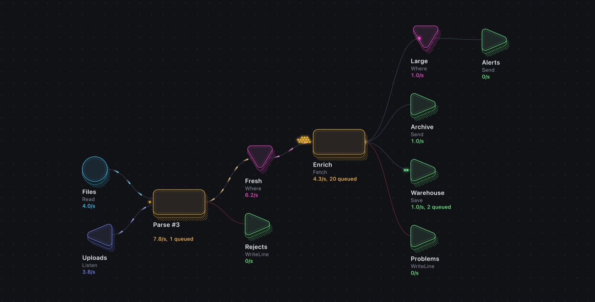
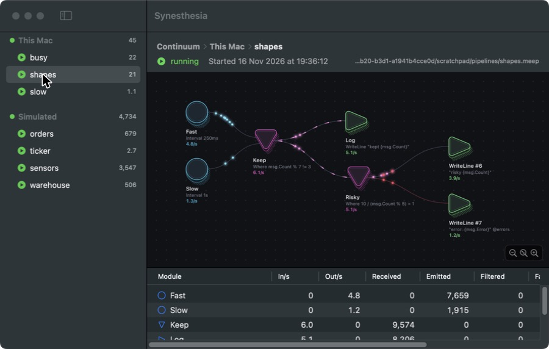

# Step 2: the pipeline canvas

Written 16 November 2026. The second step of the order of work in [architecture-round-1.md](architecture-round-1.md), section 11: the pipeline canvas, for watching only. It has the layout, the Metal stage, wires, and particles, queues and errors drawn from live counts. Built against Meep2 at ee030d7, which counts what each link carries. Nothing is committed.

## What's built

- **`MeepClient`:** each link's `carried` and `errors` (`LinkDetail`), and each module's `passed`. Counts a daemon leaves out read as 0, so older daemons still work.
- **`ContinuumKit`:** `MeepLink`, with each link's counts and rates. A link kept through a reload keeps its object.
  - **Watched pipelines:** a pipeline that a view is showing (`watchers`) gets its counts 5 times a second. Others still get them once a second.
- **`Simulation`:** link counts worked out as Meep2 keeps them. Errors pass along every link, and a module with `@errors` takes only errors. Modules can also drop messages. Two more demo pipelines have merges, fan-outs and error handlers: `sensors` reworked, and `warehouse` (11 modules).
- **`LayoutKit`** (new): a layered layout written in Swift (Q3).
- **`Stage`** (new): the scene, independent of the renderer.
  - **Contents:** tiles, wires, text, particle streams, the camera with eased moves, and hit-testing.
  - **`PipelineStage`:** builds the scene from a pipeline each frame. It lays the pipeline out again when the graph changes, easing tiles to their new places.
- **`MetalStage`** (new): the renderer.
  - **Draw calls:** one instanced draw each for the grid, the shadows, the wires, the particles, the tiles and the text.
  - **Text:** a glyph atlas of signed distance fields made with Core Text.
  - **Images:** it can also draw a scene to an image, for tests.
- **`SynesthesiaUI`:** the canvas sits above the module table, with a divider you can drag.
  - **Hover card:** hovering shows the numbers behind a tile or wire: the whole label, every count that isn't zero, the file and line, and what the particles mean.
  - **Zoom buttons:** they sit in the corner.
  - **No AppKit:** the platform's drawing view comes through the environment (`CanvasSurfaceProvider`), so this target imports no AppKit.
- **`SynesthesiaMac`:** a Metal view (`MTKView`) that draws every frame.
  - **Gestures:** it turns the pointer, trackpad and mouse into the stage's gestures.
  - **VoiceOver:** it describes each tile and wire as an element.
  - **View menu:** Zoom In (⌘=), Zoom Out (⌘-) and Zoom to Fit (⌘0).

### What the canvas shows

| Count | Drawn as |
|---|---|
| carried, on each link | particles along its wire, tinted by the module they come from |
| errors, on each link | red particles on the same wire; a wire to an `@errors` module is dark red |
| held back by a filter | particles that fade out inside it |
| dropped | orange particles spilling off the bottom of the tile |
| expired | grey particles rising off the top of the tile and fading |
| queued | a heap of dots on the wire at the module's input: one each up to 8, then more slowly, up to 30 |
| failed, refused | a red flash and glow on the tile, fading over 0.7 seconds |

- **Honest particles (Q6):** below 5 messages a second, each dot is one message.
  - **Messages:** a rise in a count starts that many dots, spread over the time the rise took, so they arrive one by one, an update behind.
  - **Rates:** above 5 a second, particles become streaks. Their density follows the log of the rate: 3 per 100 points at 5 a second, rising to at most 14 at about a million.
  - **No flickering:** they don't go back to single dots until the rate is below 3.
  - **Hover:** the card says which kind you're looking at.
- **Labels:** each tile has its name, then its verb and first parameter (`Where msg.Count % 7 != 3`), then its rate in its role's colour, and how many are queued. The text is aligned left under the tile. Text too small to read isn't drawn.
- **When counts aren't current:** tiles turn grey and particles and rates stop, but the layout stays. This happens when the host can't be reached or the pipeline has ended.
- **The theme notes:**
  - **Background:** off-black with a faint grid of dots.
  - **Tiles:** each has a face and a side showing below it, like a Mahjong tile. Its outline is in its role's colour, with a bevel inside.
  - **Shadows:** hatched shadows fade to a flat tint when you zoom out far enough that the lines would blur.
  - **Shapes by role:** circles for sources, an inverted triangle for filters, triangles pointing left for inlets and right for outlets, and rounded rectangles for everything else.

### Gestures

- **Moving the view:** scroll with two fingers or the wheel, or drag the background.
- **Zooming:** pinch, or hold ⌘ and scroll; either zooms around the pointer and follows your fingers.
- **Zoom steps:** ⌘=, ⌘- and the corner buttons zoom a step, eased.
- **Fitting:** ⌘0, double-clicking the background, or a two-finger double tap fits the whole pipeline. Until you move the view yourself, it follows the layout and eases to fit when the pipeline changes.
- **Selecting:** a click selects a tile, which glows. ⌘-click adds or removes one, as in Finder; ⌃-click is left alone (UX notes).

### Tests

- **76 tests in 15 suites, all passing:** step 1 had 33.
- **Layout:** chains, fan-outs, merges, long edges, cycles, crossings, overlaps, repeatability, keeping an earlier order, and speed.
- **Stage:**
  - tiles shaped by role;
  - wires leaving and arriving at the right edges;
  - everything fitting in the view;
  - particles, errors and drops following the counts;
  - greying when the host is gone;
  - hit-testing;
  - selection;
  - the camera and its easing;
  - text measurement.
- **Renderer:** draws three simulated pipelines and a zoomed one off screen, and checks what it drew. With `SYNESTHESIA_SNAPSHOTS` set to a folder, it saves them as PNGs.
- **Hover cards:** rendered off screen.
- **Live daemon:** the tests against a real daemon still pass on Meep2 ee030d7.
- **In the app:**
  - I ran the app against the test daemon and the simulated host: selected a pipeline, clicked a tile, used Zoom In, stopped the daemon (the canvas went grey with the banner), and started it again (it reconnected, with counts from zero and no burst of particles).
  - I couldn't check hovering in the app, because the tools I use there can't move the pointer. The hover logic is tested, and the cards were rendered off screen.

## Decisions made while building

- **The layout, in Swift (Q3).**
  - **Columns:** each module goes one column after the latest module feeding it. A source sits just before what it feeds, so a `+` chain's second timer doesn't trail a long wire.
  - **Order within columns:** starts from the order the file is written in, then reorders by barycentres with neighbour swaps to cut crossings. An earlier layout's order wins ties, so a reload moves as little as it can.
  - **Placement:** each column is placed by least squares with its order and gaps kept (pooling adjacent violators). That's simpler than Brandes–Köpf, and it straightens chains exactly.
  - **Speed:** in a release build, laying out 11 modules takes 1 ms and 100 modules 15 ms.
  - **Pins:** none yet.
- **All tiles are the same height,** and every label block too. A layout that lines up the middles of the nodes then lines up the tiles, so wires between them run straight.
- **Tiles line up on their left edges in each column,** with their labels aligned left beneath them. This follows your note on aligning text left.
- **Distance fields from glyphs drawn four times larger.** The first version cut each glyph's coverage at half, which made zoomed-in text stair-stepped. Drawing at four times the size puts edges between pixels.
  - **Cost:** each glyph is made once, on first use. I haven't timed that in a release build; in a debug build it's slow enough that the renderer's tests take 25 seconds.
- **Shaders compile from source when the canvas starts,** because `swift build` doesn't compile `.metal` files. When there's an Xcode project for the iPad, they can move to a `.metal` file.
- **What a filter holds back is worked out.** Meep2 counts `passed` now, but has no count for what a filter keeps back. Synesthesia takes it as handled − passed − emitted, for filters only.
  - **Not `filtered`:** Meep2's `filtered` means something else: messages a module's options exclude, such as other messages reaching an `@errors` module. Those aren't on the link either, so nothing is drawn for them. The design's particle table used "filtered" for what a Where holds back; that should read "held back".
- **Dragging the background pans.** In step 5, dragging a tile will move it instead.
- **The window is now at least 520 points tall,** so the canvas and table both fit.

## Not done yet

- **Load as the tile's fill, cool to hot:** this needs each module's handling time, which comes with the digests (prompt 5).
- **Pins (Q7):** pins go in `.synesthesia/`, keyed by module identity. They fit better with editing on the canvas (step 5), where dragging a tile has to mean something.
- **Levels of detail beyond hiding small text:** a pipeline becoming a district on its host comes with the continuous zoom in step 7.
- **VoiceOver isn't checked.** The canvas describes each tile and wire with its rate, but this session isn't allowed to read the app's accessibility tree, and I haven't run VoiceOver.
- **Frame time isn't measured.** I haven't timed a frame, or tried a pipeline of thousands of modules.

## Next

**Step 3, the MCP server, early,** with the tools for looking and showing. It lets Claude Code sessions check what the app shows while the rest is built, without screenshots. It needs nothing from Meep2.
