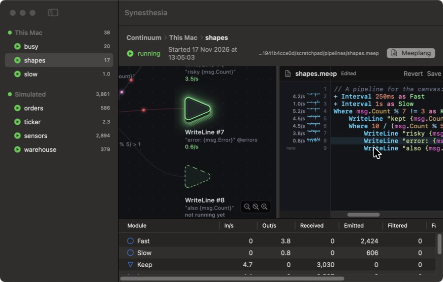
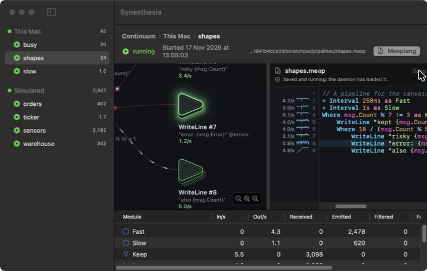
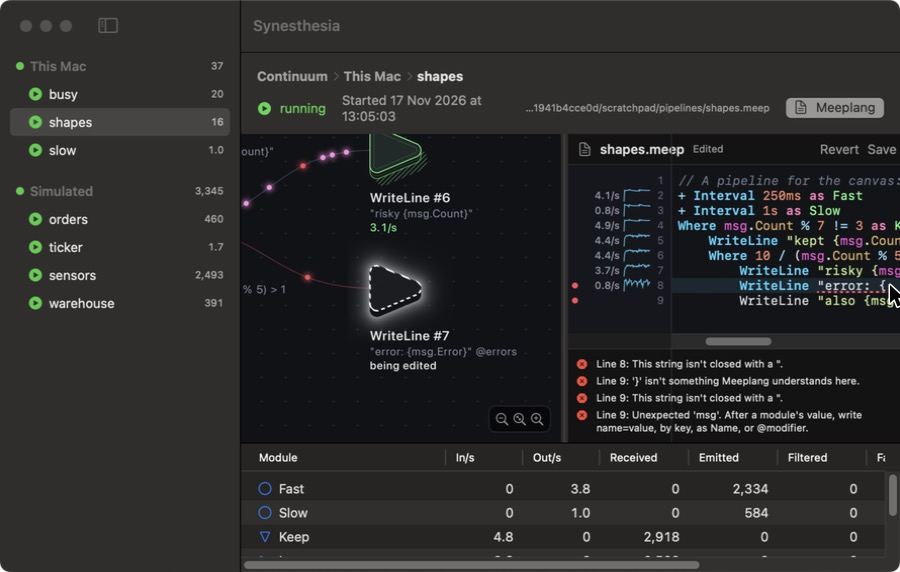

# Step 4: Meeplang beside the canvas

Written 17 November 2026. The fourth step of the order of work in [architecture-round-1.md](architecture-round-1.md), section 11. A pipeline's Meeplang opens beside its canvas, coloured and checked by `meep lsp`. As you type, the canvas follows the text, keeping each tile's counts. Each module's rate and last minute show in the gutter, and the selection is shared both ways. Saving a file the daemon watches runs the change at once. It uses prompt 3 from Meep2 (2ef2d35 and 810c2fc), and needed nothing more from it. Nothing is committed.

## What's built

- **`LanguageClient`** (new, with no UI): the Language Server Protocol over any byte stream, with `meep lsp`'s additions.
  - **The protocol:** `Content-Length` framing, requests by id, and notifications.
    - **In order:** messages go out in the order they're given, so a change always reaches the server before a question about it.
    - **Answering the server:** requests from the server are answered with null.
  - **`MeepLanguageServer`:**
    - **Documents:** opening, changing and closing them.
    - **The graph:** `meep/graph`, with its `meep/graphChanged` notifications, and `meep/setBase`.
    - **Text services:** semantic tokens (asked for as changes, applied to the last full set), hovers and completions.
    - **Verbs:** `meep/verbs`.
  - **On the Mac,** `LanguageServerProcess` finds `meep` and starts `meep lsp`.
    - **Finding `meep`:** `$MEEP_EXECUTABLE`, then `PATH`, then the login shell's `PATH` (which an app opened from the Finder doesn't have), then the usual places for .NET tools.
- **`Transport`:**
  - **`PipeStream`:** a byte stream over a program's standard input and output.
  - **`MemoryStream`:** the in-memory pair the tests used, moved here.
- **`CodeEditing`** (new, with no UI): a pipeline's text as it's edited.
  - **`LanguageService`:** the app's one `meep lsp`.
    - **Starting:** it starts when first needed, and again if it stops. After three stops in a minute it waits before trying again.
    - **Sharing:** it routes each notification to its document, and sends everything through one queue.
  - **`MeeplangDocument`:** the text, its version, colours, problems and graph, and whether it's saved.
    - **Keys the daemon's:** it gives the server the running pipeline's graph and text as a base, and again after each reload. So a module the daemon runs has the daemon's key while it's typed, and its tile keeps its counts.
    - **Renames:** keys the server renames are passed on, so tiles move to their new keys before the canvas draws.
    - **Saving:** it writes the file in place and waits for the daemon to load it. If no reload comes within two seconds, it says the daemon isn't watching the file and offers Reload, which asks the daemon to reload.
    - **Changes elsewhere:** it watches its file. Another editor's save is taken when nothing here is unsaved; when something is, it says so.
    - **Other hosts:** a pipeline on another host opens read-only, from its daemon.
  - **`LineIndex`** turns the protocol's positions and Meep's spans into text offsets, in UTF-16.
  - **`Highlight`** turns semantic tokens into styles, such as verb, inflection, name, constant, `msg` or decorator.
- **`MeepClient`:** a host can be asked for a pipeline's source text (`GET /pipelines/{name}/source`) and to reload it.
  - **Simulated pipelines** can have text, for tests, and be reloaded with a new graph version, which their stats stream announces as the daemon does.
- **`ContinuumKit`:**
  - **The link:** a connected host keeps its link, for requests beyond what its session follows.
  - **Rate history:** each module keeps its rate for the last minute, one sample a second (`RateHistory`, in FlowKit), for sparklines.
- **`Stage`:**
  - **The text's graph:** while the text is open, the stage draws the language server's graph of it rather than the daemon's, with counts from the running modules and links by key (`StageModule`, `StageLink`).
  - **Not running yet:** a module that's in the text but not running is drawn as a ghost (a faint face and a dashed outline), labelled "not running yet".
  - **Being mended:** while the text doesn't load, the canvas keeps the last graph that did, and draws modules in the lines being mended dashed and white, labelled "being edited".
  - **Renamed keys** move tiles, flows and the selection all at once, so two keys can swap.
  - **Opening the text:** pinching on past the closest zoom over a tile, or double-clicking it, asks for the text at that module (design, section 2). So does ⌘= at the closest zoom with a tile selected.
- **`SynesthesiaUI`:**
  - **The text pane** sits beside the canvas.
    - **Header:** the file, and whether it's saved and running ("Saved and running", "isn't watching this file", "doesn't load", "changed on disk"), with Save, Revert and Reload.
    - **Below it:** the platform's text view.
    - **Problems:** a list, each going to its line.
    - **Resizing:** its edge can be dragged, and a double-click puts back the usual width, which is remembered.
  - **The hover card** works for modules only in the text.
- **The Mac's text view** (`SynesthesiaMac`) uses TextKit 2.
  - **Colours** come from the semantic tokens, in the canvas's palette.
  - **Problems** are underlined, with the message on hover.
  - **The gutter** has line numbers, a red dot on lines with problems, and each module's rate and a sparkline of its last minute, refreshed once a second.
  - **Shared selection:** the cursor's module is selected on the canvas, which eases to it if it's out of sight. A module selected on the canvas lights its lines and scrolls the text to it. The module under the pointer is lit on the canvas, and the other way round.
  - **Hovers:** resting on a word shows `meep lsp`'s hover.
  - **Completions:** ⎋ asks for them.
  - **Typing:** new lines keep the indentation, and Tab types four spaces.
- **The app:**
  - **Menus:** View › Show Meeplang (⌥⌘T); File › Save (⌘S) and Revert to Saved.
  - **Quitting with unsaved changes** asks whether to save them.
- **MCP tools:**
  - **`read_pipeline_text`:** from the open text, marked when it has unsaved changes, or from the daemon on any host. Before, it read only this Mac's files.
  - **`describe_verbs`:** new, from the verb catalogue.
  - **`describe_view`:** now describes the text pane, and marks tiles not running yet or being mended.

## Tried in the app

Against a test daemon running `shapes.meep` with `meep start --watch`:

- **Typing a module** at the end put it on the canvas within a moment, dashed and "not running yet", with "new" in the gutter (above).
- **Saving** ran it: "Saved and running: the daemon has loaded it", a solid tile at 5 messages a second, with particles. The tools showed the editor's key and the daemon's were both `m8`.

  
- **Mid-string by mistake:** a line typed into the middle of a string listed four problems, marked their lines in the gutter, and drew the module being mended dashed white. Revert put it back.

  
- **Selection:** clicking a line selected its tile, and the canvas eased to it. Showing a module through the `show` tool lit its lines.
- **A pipeline the daemon wasn't watching:** after saving, it said so within two seconds and offered Reload, which ran the change.

## Tests

- **118 tests in 26 suites, all passing,** twice in a row, with the live tests against the test daemon and the real `meep lsp`; step 3 had 94.
- **Faster:** the whole run takes about 10 seconds; before this step it took over a minute. See the last decision below.
- **About the new tests:**
  - **`LanguageClientTests`:**
    - Framing across chunk boundaries.
    - Reading the captured answers of `meep lsp` (`Fixtures/`, from Meep2 at 810c2fc): the graph, the broken graph, tokens, hovers, completions and verbs.
    - A scripted server checking order, null bases and notifications.
    - A live test against the real `meep lsp` when `MEEP_EXECUTABLE` is set: inserting a module keeps every other key, and token deltas add up to what a fresh full request gives.
  - **`CodeEditingTests`:**
    - A document against a fake server and a simulated daemon: opening, colouring, edits in order, problems, saving.
    - The base sent and renames passed on.
    - Waiting for a reload, and saying when none comes.
    - A file changed elsewhere, taken or not.
    - A file saved by another editor, in place or by replacement.
    - UTF-16 offsets, and token styles.
  - **MCP:** the text from the daemon, and `describe_verbs`.

## Decisions made while building

- **One `meep lsp` for the app,** shared by every open document, rather than one for each. It costs one process, and a document opened later gets its colours at once.
- **The canvas draws the text's graph only while the text shows.** Hidden text with unsaved changes stays open, but the canvas goes back to what runs, so it never shows unsaved modules without the text that explains them.
- **The text is saved, not sent.** Saving writes the file, and the daemon's own watching reloads it (design, section 5). Nothing is saved as you type: a half-written pipeline that happened to load would run.
- **Saving writes the file in place,** so a watcher on the file sees it change.
- **Whether the daemon is watching is worked out:** after saving, it waits two seconds for a reload. `PipelineSummary` doesn't say whether the daemon is watching, so prompt 4 now asks for that.
- **The source and then the graph** are fetched for the base. If a reload falls between them, the server is given a graph newer than the text, which it refuses, rather than an older one, which it might take.
- **Colours for older text aren't applied.** The text keeps its previous colours until the tokens for what's typed now arrive, about 40 milliseconds after typing stops.
- **The gutter lays out beside the text itself:** this `NSScrollView` put its ruler over the text rather than beside it, so `CodeScrollView` tiles it.
- **A line is revealed at its start,** so selecting a long line on the canvas doesn't scroll the text sideways.
- **MetalStage is compiled optimised, even in debug builds.**
  - **The cost before:** drawing each glyph's distance field took seconds unoptimised, on the main thread. A debug app's first canvas stalled for about ten seconds, so `meep lsp`'s first answer reached the text twelve seconds late. In the tests, the renderer's tests held the main thread for 40 seconds, which made other suites' timing tests fail.
  - **After:** the renderer's text test takes 0.75 seconds instead of 6 to 8.
  - **How:** it's an `unsafeFlags(["-O"])` setting for that one target in `Package.swift`, which SwiftPM allows in a root or local package.

## Not checked

- **Completions and hovers in the app:** they're wired to `meep lsp`, and the client reads its answers in the tests. But I didn't open a completion list or a hover in the app.
- **Zooming past the closest zoom to open the text, and double-clicking a tile:** built, and the request is tested through the stage, but not tried with a trackpad in the app.
- **VoiceOver** in the text and gutter.

## Not done yet

- **Roles Meep2 has added:** `router` (Distribute) and `tap`. The canvas still draws them as steps.
- **Editing another host's text:** it opens read-only. Editing it (`POST /pipelines/{name}/edits`) comes with the host level, step 7.
- **Edits on the canvas:** step 5, with prompt 4.
- **The code level** (C# from the verb catalogue's source locations): step 10. The catalogue already gives each class's file and line.

## Next

**Step 5, editing on the canvas:** gestures become Meep2's edits through `meep/applyEdits` (prompt 4, which now also asks the daemon to say when it's watching a file). One gesture is one undo step in the text's undo.
