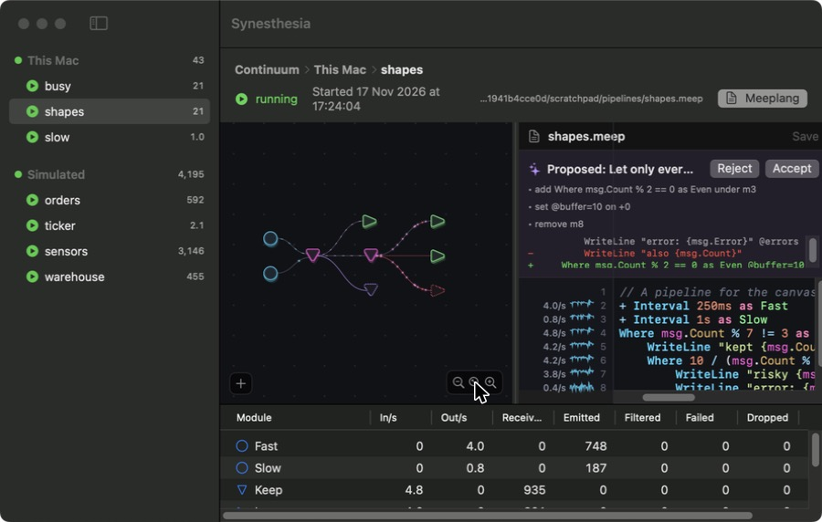
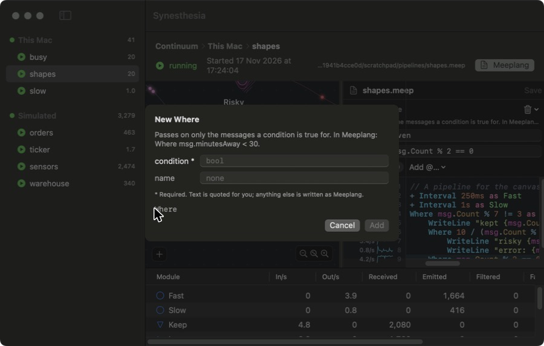
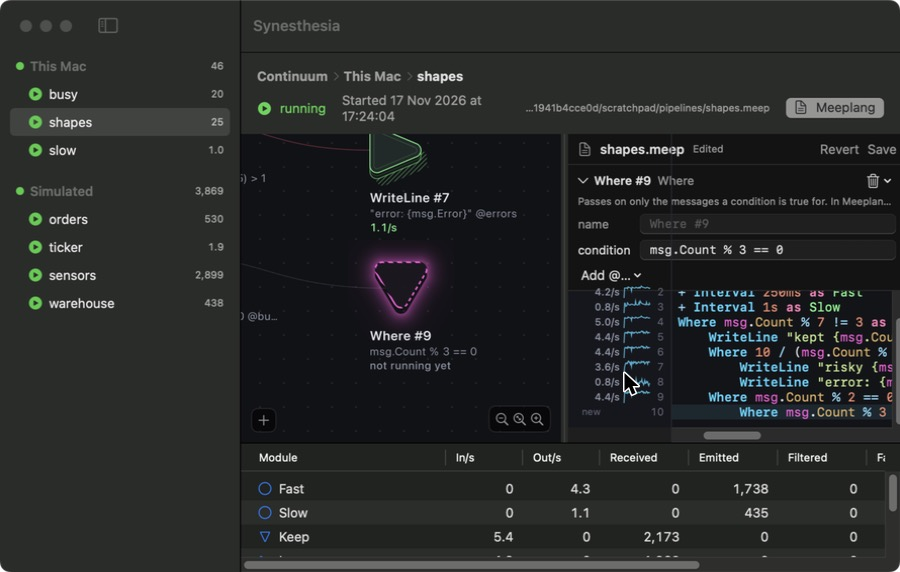

# Step 5: editing on the canvas

Written 17 November 2026. The fifth step of the order of work in [architecture-round-1.md](architecture-round-1.md), section 11: gestures on the canvas become edits of the pipeline's text, with one undo history, and proposed edits are shown before they're made. It uses prompt 4 from Meep2 (0278da4 and 001842b, now on Meep2's `main`): `meep/applyEdits` with previews, keys for new modules, `+N`, and whether the daemon is watching a file. Nothing is committed.

## What's built

- **Gestures as edits** (design, section 5). Each is one of Meep2's own edits, made by `meep lsp`, or one the canvas writes itself (Q2). Each is one step in the text's undo history.
  - **Delete:** ⌫ deletes the selected modules, and the modules under them move up (`remove`). ⌥⌫ deletes them with everything under them (`remove-branch`). A tile's menu has both, and Show in Text.
  - **The inspector,** above the text when one module is selected, gives:
    - **The module:** its verb and inflection, and its description.
    - **Its name:** `rename`.
    - **Each parameter:** from the verb catalogue, with its type, default and description on hover, and the value written now. Return or leaving the field sets it (`set`); emptying it takes it out (`unset`).
    - **Its modifiers:** shown as chips that can be removed (`remove-modifier`), and added from a menu (`set-modifier`).
  - **The palette** (the + at the canvas's bottom left) lists every verb the pipeline can use, by role, with descriptions and a search field.
    - **Dragging a verb:** onto a tile adds it under that tile (`add`). Onto a wire puts it between the wire's ends (`insert`). Onto the background adds it as a new line at the end, as for a source. What it would land on lights up as it moves.
    - **Clicking a verb** adds it under the selected tile.
    - **Required values first:** a verb with required parameters asks for them before it's written, showing the line it will write. Text values are quoted for you.
    - **After it's written,** the new module is selected.
  - **Moving:** ⌥-dragging a tile onto another moves it, and everything under it, under that tile. Meep2 has no edit for this, so the canvas writes the text itself (`BranchMove`, in CodeEditing).
    - **What moves:** the branch's lines, with any comment written right above it, put after the target's branch at the indentation of the target's other modules.
    - **Keys:** Meep2's matching keeps the moved modules' keys (Q195).
    - **Refused:** moves into a module's own branch, out of templates and includes, and of `+` lines, each saying why.
  - **On a wire into one of several branches,** where `insert` would take every branch, the module is added as a new branch and the wire's target moved under it. That's written as one change, worked out from a preview of the add.
  - **Merges** (wiring a module into a second input) aren't built yet; see below.
- **Every edit shows in the text.** The text opens beside the canvas for the first edit, and edits wait until its keys are the daemon's. If an edit can't be made, a notice on the canvas says why, in `meep lsp`'s words, and nothing changes.
- **One undo history** (`MeeplangDocument.undoManager`). Typing in the text view, edits on the canvas and accepted proposals are all in it. ⌘Z undoes whichever came last, from the canvas or the text, and each undo reaches the language server as a change like any other.
- **Proposals** (design, section 8). The MCP tool `propose_edits` takes a pipeline, a summary and a list of edits. The app opens the pipeline and its text, and shows the edits before anything changes:
  - **On the canvas:** new modules as violet ghosts labelled "proposed"; changed ones marked "changed"; ones to be taken out kept where they are in red, "to be removed".
  - **Above the text:** the summary, each edit in words, and the lines it would change.
  - **Deciding:** Accept (⌘↩) makes the edits as one undo step, and Reject drops them.
  - **What the tool answers:** accepted, with the new modules' addresses; rejected; withdrawn, when another proposal replaced it; or undecided after its timeout, with the proposal still showing.
  - **Saving is the person's:** accepted edits are in the text, not saved.
- **Watching:** `PipelineSummary` and `PipelineDetail` read `watching`.
  - **A daemon that says it isn't watching** gets "isn't watching this file" and Reload at once on saving, rather than after two seconds.
  - **One that says it is** gets a longer wait before "hasn't loaded it yet".
  - **A reload that comes late** still counts as loaded.
- **`LanguageClient`:** `meep/applyEdits`, `MeepEdit` with each kind of edit, and refusals that say which edit failed and the server's version.
- **`CodeEditing`:**
  - **`MeeplangDocument`:**
    - **Editing:** `apply(_:named:)` makes a list of edits as one undoable change, asking again if the text changed meanwhile. `change(to:named:)` makes a change the canvas writes itself.
    - **Proposals:** `propose`, `decision(on:)`, `acceptProposal` and `rejectProposal`.
    - **Waiting:** `ready()` waits until the keys are the daemon's.
  - **`TextDifference`:** the one stretch that changed, for the view to replace; and the server's text edits applied.
  - **`DiffLine`:** a line diff for showing proposals.
  - **`BranchMove`:** the text for a move.

## Tried in the app

Against a test daemon running `shapes.meep` with `meep start --watch`, from Meep2's `main` at 001842b:

- **Delete:** selecting Risky and pressing ⌫ took it out of the text and the canvas, and its three WriteLines moved up under Keep with their keys and counts. Edit › Undo put it back, and the text was no longer marked edited.
- **A proposal through `propose_edits`:**
  - **The edits:** add a Where under Keep, give it `@buffer=10` by `+0`, and remove a WriteLine.
  - **What the app showed:** the ghost filter in violet, the WriteLine in red, and the diff and the edits in words above the text (top).
  - **Accepting:** the tool answered "accepted" with the new module's address. The text gained the filter and lost the WriteLine.
  - **Saving:** "Saved and running", with the filter at 3.5 messages a second.
- **The palette:** clicking Where with that filter selected asked for its condition. The form showed the line it would write, and Add put it under the filter. The new module was selected, with its inspector, and drawn as a ghost "not running yet" (below). Revert took it back out.

## Tests

- **137 tests in 32 suites, all passing,** three runs in a row, with the live tests against the test daemon and the real `meep lsp`; step 4 had 118.
- **Fragile under load:** two earlier full runs had a timing test fail while the machine's load average was 15 to 18. The particle and host-session tests now wait for what they test, up to ten seconds, instead of for a fixed time. The 100-module layout limit in debug builds is 2.5 seconds instead of 1: it's there to catch the 8 seconds layout once took.
- **New:**
  - **`LanguageClientTests`:**
    - The captured answers of `meep/applyEdits` (`Fixtures/apply-*.json`).
    - Refusals carrying the edit and the version.
    - A live round trip: the text edits of a preview, applied as an editor would, give exactly the preview's graph, and the new module keeps its key.
  - **`CodeEditingTests`:**
    - Edits as one step that can be undone and redone, each reaching the server in order.
    - A stale version asked about again, and a refusal's reason passed on.
    - A proposal changing nothing until accepted; rejected; withdrawn by another.
    - A daemon that says it isn't watching.
    - `TextDifference`, `DiffLine` and `BranchMove` (with a comment above the branch, a target with nothing under it, and the refusals).
    - A live test with the real `meep lsp`: an edit, its undo, a move that keeps its key, a proposal accepted, and an edit refused.
  - **`StageTests`:** a proposal's added, changed and removed modules, and their colours and labels.
  - **`SynesthesiaUITests`:** a new module's line, with text quoted, and edits in words.
  - **MCP:** `propose_edits` reaching the app and reporting each outcome.

## Decisions made while building

- **Edits go through the text.** The canvas never changes what runs: an edit changes the text, and saving runs it, as in step 4. Undo is the text's.
- **The first edit opens the text beside the canvas,** so the change is seen in both. The canvas draws the text's graph only while the text shows (step 4), so editing with the text hidden would have shown nothing changing.
- **Edits wait for the daemon's keys.** Before `meep/setBase` has answered, the document's keys are its own numbering, and an edit naming `m5` could name the wrong module.
- **The document's undo manager is the text view's.** The view registers its typing there, through `undoManager(for:)`, and the document registers each edit, so there's one history. The view makes the document's changes to its text without an undo of its own.
- **A change is replaced as one stretch** (`TextDifference`): only what changed, so the cursor and scrolling stay where they were.
- **Moves are written in Swift, with Meep2 checking them.** That follows Q2. They change only indentation and line order, `meep lsp` checks the result, and Meep2's matching keeps the keys. Templates, includes and `+` lines are refused rather than guessed at.
- **A proposal is made against a version.** Accepting it unchanged applies its text. If the person has typed since, the same edits are asked for again on the text as it is.
- **The tool waits for the person,** up to five minutes by default (ten seconds to thirty minutes), and says "undecided" rather than withdrawing when time runs out.
- **The palette's rows are buttons,** so VoiceOver can use them as well as the pointer. Drag-only rows had no way in from the keyboard.
- **A late reload counts:** if the daemon reloads after the wait, the text says it runs as saved.

## Not checked

- **Dragging a verb onto a wire or the background, and ⌥-dragging a tile,** weren't tried in the app. Background control can't hold a modifier during a drag, or drag out of a popover. The code paths they use are tested: wire inserts and moves through `BranchMove` against the real `meep lsp`, and drops through the stage's hit-testing. Clicking in the palette, which uses the same path as a drop on a tile, was tried.
- **Typing in the inspector's fields** wasn't tried: background control can't type into them. The same edits went through the canvas and a proposal.
- **⌘Z with the canvas focused** was tried through the Edit menu, not the key.

## Not done yet

- **Merges:** wiring a module into a second input means turning chains into `+` lines or adding a Tap. That's a larger change to the text than a move. The canvas refuses a drop onto a merging wire, and says so.
- **Pins** (design, section 5, "Positions"): layout is automatic.
- **Editing another host's text:** step 7, through the daemon's edits, which now take keys too (Meep2 Q199).
- **A daemon older than Meep2 0278da4** doesn't say whether it's watching, so saving falls back to waiting two seconds.

## Next

**Step 6, probes and injection:** taps on a wire or module to see real messages, drawn apart from the honest particles, and injecting messages, confirmed in the app.
