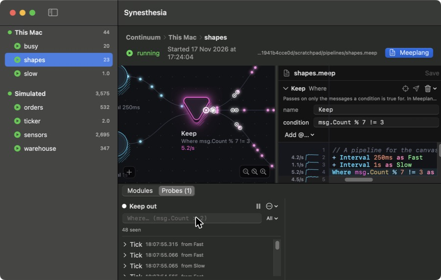
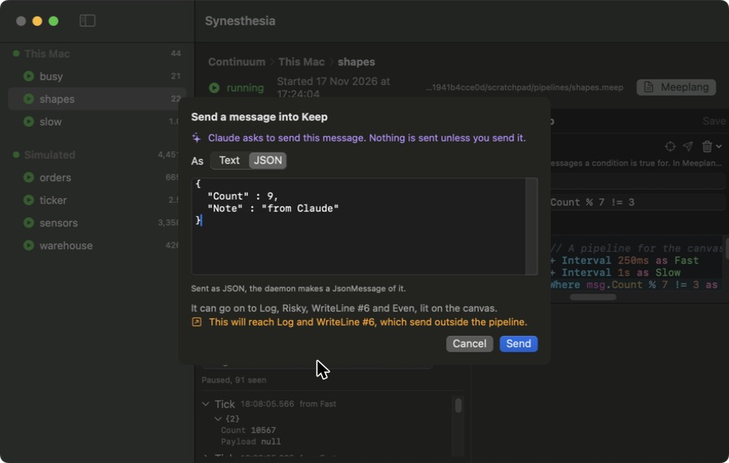
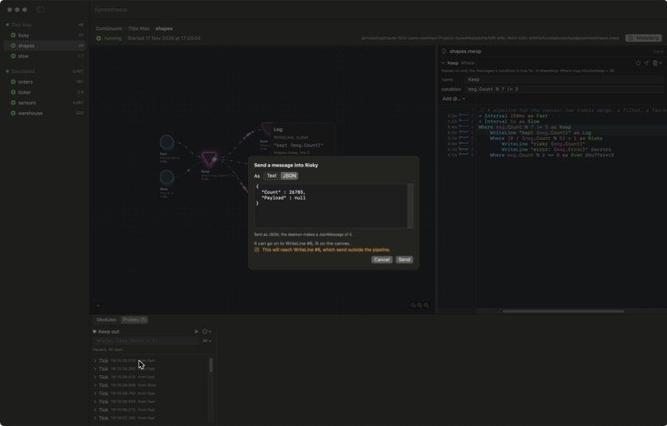

# Step 6: probes and injection

Written 17 November 2026. The sixth step of the order of work in [architecture-round-1.md](architecture-round-1.md), section 11: debugging at level 3 works like a patch bay (design, section 6). Probes on a module's output or a wire show the real messages that go past, and those messages are drawn on the canvas as tracers. Messages can be sent into any module, with the path they'll take lit first. It needed nothing new from Meep2: the daemon already had debug taps and injection. Nothing is committed.

## What's built

- **Probes** (`Probe`, in ContinuumKit) go on a module's output or on one wire.
  - **The tap:** each is a debug tap through the host (`GET /pipelines/{name}/modules/{n}/tap`). It keeps the latest 200 messages, newest first.
  - **Counting what's missed:** it counts what the tap left out because the view fell behind ("312 not shown"). The runtime leaves messages out rather than slow the pipeline.
  - **A wire into an @errors module** is tapped for errors only. The condition `msg is ErrorMessage` is added to the person's own.
  - **The filter is a Meeplang condition** on `msg`, as `Where` takes, so it's the same language. A refused condition ends the probe, saying why in the daemon's words.
  - **A sample** (every message, 1 in 2, 10 or 100) sets the share shown.
  - **Reloads:** a reload that renumbers the module opens the tap again, since the daemon finds modules by number.
  - **Pausing:** probes stop while their pipeline isn't showing, and start again when it is.
- **Saved probes** go in `.synesthesia/probes.json` beside the pipeline's file (Q7), with what each was on, its condition and its sample. They open again with the pipeline. A module whose key changed when the pipeline started again is found by its name.
- **The canvas:**
  - **A probe's mark:** a ring in the probe's colour where it sits, at the module's outlet or half way along the wire.
  - **Tracers:** each message it sees crosses its wires as a ring round a bright core, a third particle style (design, section 4: "Tracers"). Real messages look unlike the dots and streaks counts make. Errors go along @errors wires.
  - **Clicking:** clicking a mark or a tracer opens the probe in the dock, with that message open.
  - **Sending a message in** is drawn arriving at its module.
  - **A message's path,** before it's sent, is lit: everything downstream along wires that aren't errors only.
- **The dock under the canvas** switches between the modules' counts and the probes, side by side.
  - **Each probe shows:** its condition, its sample, what it has seen and missed, and its messages.
  - **Each message shows:** its type, time and the module that made it. Opened, it shows its content as a tree, and its ancestors (`fam`) as buttons that pick out the module that made each.
- **Sending messages** (design, section 6):
  - **The composer** sends text or JSON into a module (`POST …/inject`). It names where the message can go, lit on the canvas, and warns when it will reach outlets: "This will reach Log and WriteLine #6, which send outside the pipeline."
  - **The inject capability:** without it, Send is off and the composer says so.
  - **Resending:** a message dragged from a probe onto a tile, or onto a wire for the wire's target, opens the composer with its content, to send it there as JSON.
- **Opening them:**
  - **A tile's menu:** Probe Output and Send a Message.
  - **A wire's menu:** Probe Wire.
  - **The inspector** has a button for each, since a menu alone is hard to find.
- **MCP tools:**
  - **`sample_tap`** listens to a module for a few seconds and returns its messages, with their content and ancestors, and how many the tap left out. It says these are real contents and may be sensitive (design, section 8).
  - **`inject_message`** opens the composer with Claude's message, marked as Claude's, and waits for the person. Nothing is sent unless they send it.
  - **`describe_view`** lists the probes.
- **`MeepClient`:**
  - **Taps:** `TappedMessage`, taps and their conditions, on the daemon and the simulated host.
  - **Injection:** `InjectBody` and `Injected`.
  - **JSON:** `JSONValue`, moved from Assistant so message content can use it.
  - **The simulated host:** taps of made-up messages at each module's rate, and injection when it's made with the inject capability.

## Dragging, fixed after you tried it

You found that dragging verbs from the palette, and messages from probes, did nothing. Each drag failed for its own reason:

- **The drags never started.** Both lists' rows were buttons with `.draggable`, and a button on the Mac tracks the mouse itself. The rows now react to a click and start a drag with `.onDrag`, and still read as buttons to VoiceOver.
- **The canvas never took a drop.** It's an AppKit Metal view inside SwiftUI, and AppKit offers a drop to the view under the pointer. That view hadn't registered for anything, so SwiftUI's `.onDrop` around it never saw one. The canvas now registers for text and gives drops to the editor (`StageEditing.drop`).
- **The palette was a popover,** which can close mid-drag. It now docks beside the canvas, and stays open until you hide it.

What you asked for as well:

- **A plain drag on a tile moves it.**
  - **While dragging:** its ghost follows the pointer, and only tiles it can go under light up. That means not itself, nothing under it, and not where it is already.
  - **Dropped on another tile,** it moves there with everything under it.
  - **Dropped on the background,** it stays put, and a notice says what dragging a tile does.
  - **The background:** dragging it still moves the view. ⌥ isn't needed any more.
- **A message dropped on a wire** opens the composer for the wire's target.

And one thing found while trying them:

- **A verb that needs values after all** now asks for them. Batch needs a size or a time, though neither is required on its own, so dropping it bare was refused with only a notice. Now the form opens, with Meep's reason above its fields.

Each was tried by dragging in the app, against the test daemon running `shapes.meep`:

- **Even, dragged onto Log,** moved under Log, keeping its key and its counts.
- **Even, dropped on the background,** stayed put and showed the notice.
- **Where, dragged from the palette onto the wire into Risky,** asked for its condition. It then went between Keep and Risky as one change, with Risky's branch under it, since Keep has three branches.
- **Batch, dragged onto Even,** opened its form with Meep's reason. Given a size, it was added under Even and selected.
- **A probe's Tick, dragged onto the wire into Risky,** opened the composer to send it into Risky, as JSON (below).

## Tried in the app

Against the test daemon running `shapes.meep`:

- **A probe:** the inspector's probe button opened one on Keep's output (top). It listed Ticks from Fast and Slow, newest first, and rings crossed Keep's wires. Pausing stopped both, and opening a message showed its content, Count and Payload.
- **`inject_message`:**
  - **The composer:** it opened with Claude's JSON, marked "Claude asks to send this message" (above). It listed where the message could go and named the two WriteLines it would reach.
  - **Sending:** Send sent it, and the tool answered `sent`: a JsonMessage into Keep.
- **`sample_tap`:** on Risky, with `msg is ErrorMessage`, it returned two divide-by-zero errors, each with the Tick that caused it and the source that made the Tick.

## Tests

- **153 tests in 37 suites, all passing,** three runs in a row, with the live tests against the test daemon and the real `meep lsp`; step 5 had 137.
- **A test that failed under load now feeds its own counts.** The particle test stops its session once the graph is in, and gives the counts for each moment itself. It had read them from a session on the main actor, which other suites keep busy in a full run: after 11 seconds it had only 0.6 seconds' worth. It now takes 0.4 seconds and doesn't depend on the machine.
- **New:**
  - **`MeepClientTests`:**
    - A tapped error captured from the daemon (`Fixtures/tap-error.json`), with its content and ancestors.
    - A condition kept as one value of the query.
    - Live: a tap with a condition gives only messages that meet it, and a bad condition is refused; text and JSON are injected.
  - **`ContinuumKitTests`:**
    - A probe keeping the latest messages and pausing.
    - A refused condition ending it with the reason.
    - A wire into an @errors module tapped for errors.
    - Saved probes kept per file.
  - **`StageTests`:**
    - A probe's mark and tracers drawn in its colour, and clicking the mark opening it.
    - A message's path taking everything downstream but @errors wires.
  - **`SynesthesiaUITests`:**
    - Saved probes opening again with the pipeline, once, finding a module whose key changed by its name, and pausing.
    - Drops: a message on a wire going to its target, on a tile to it, and on the background nowhere, with a notice.
    - A tile dropped where it can't go saying what dragging does.
  - **`StageTests`** (tile drags): a dragged tile's ghost following the pointer, and only tiles it can go under lit.
  - **MCP:** `sample_tap` and `inject_message`.

## Decisions made while building

- **A probe on a wire taps its source's output.** The daemon taps modules, not wires. A wire into an @errors module adds `msg is ErrorMessage`. A wire from a module with several branches shows that module's whole output, the same messages each branch receives.
- **Sending is always the person's.** The composer's Send is the confirmation the design asks for (section 8, Safety), whether the person wrote the message or Claude offered it. Claude's tool waits for them and never sends by itself.
- **A message is sent to a module by its number,** found from its key just before sending, since the daemon finds modules by number or name.
- **A message sent in is drawn arriving, not followed.** A tap on the module it went to doesn't show it, as I found against the daemon. So its path is lit before sending, and its arrival is drawn, rather than drawing hops it may not take.
- **Resent messages go as JSON.** A tap shows a message's content for people to read and can't be read back as the message. Dropping one on a tile sends its content as a JsonMessage, and the composer says so.
- **Tracers are capped** at 16 per probe on screen. A busy probe still lists every message it gets in the dock.
- **`JSONValue` moved to MeepClient,** since tapped messages' content is arbitrary JSON, and Assistant already used the type.

## Not checked

- **The menus' Probe and Send items:** background control can't right-click. The inspector's buttons and the tools open the same things.
- **Typing a condition into a probe:** background control can type into the field but not press Return, so the field now also applies its condition when you leave it. Conditions are tested live through the daemon.
- **Keep with the Pipeline,** in the probe's menu, wasn't toggled in the app. Saving and reopening probes is tested.
- **Clicking a moving tracer:** clicking the probe's mark is tested; tracers use the same hit-testing.

## Not done yet

- **Sampled traces** (section 4's third kind of tracer) need Meep2's flow evidence: step 8.
- **Completion in a probe's condition** from `meep lsp`, as the design has it: the condition is a plain field for now.
- **A message's path through the pipeline after it's sent,** hop by hop, would need taps along the way.

## Next

**Step 7, host and mesh:** several daemons, SSH tunnels, roll-ups, budgets and the continuous zoom. Meep2: one subscription per connection, host identity and digests (prompt 5).
