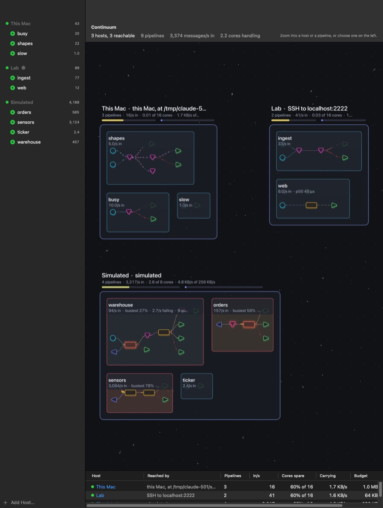
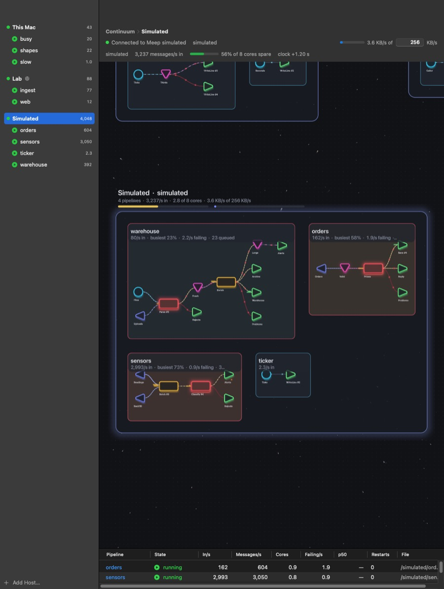
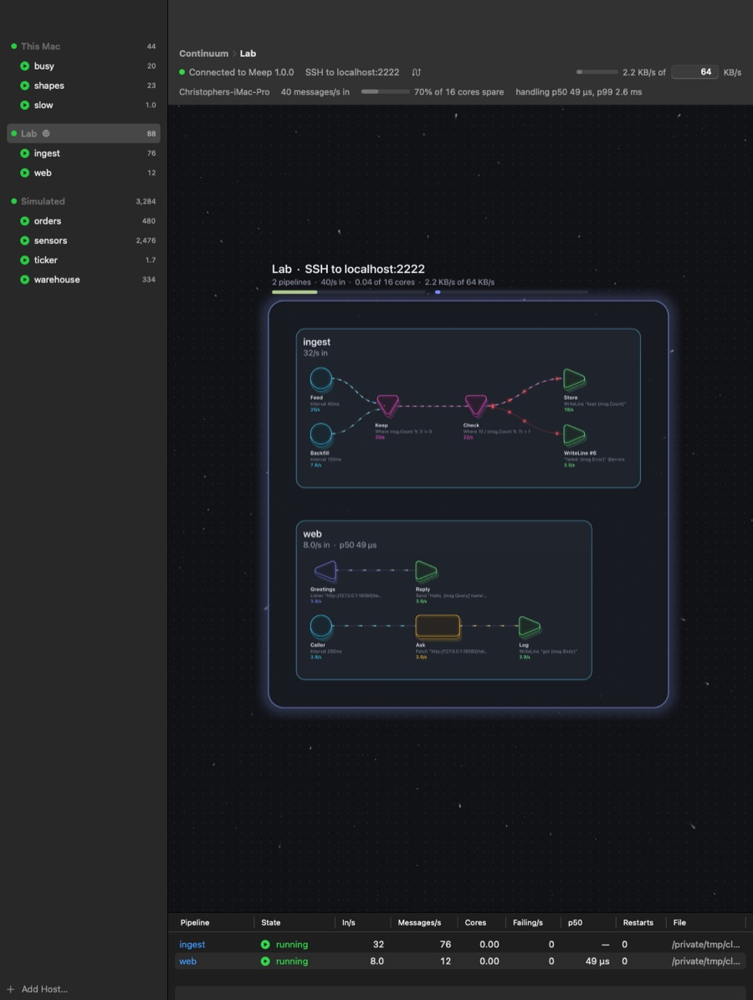
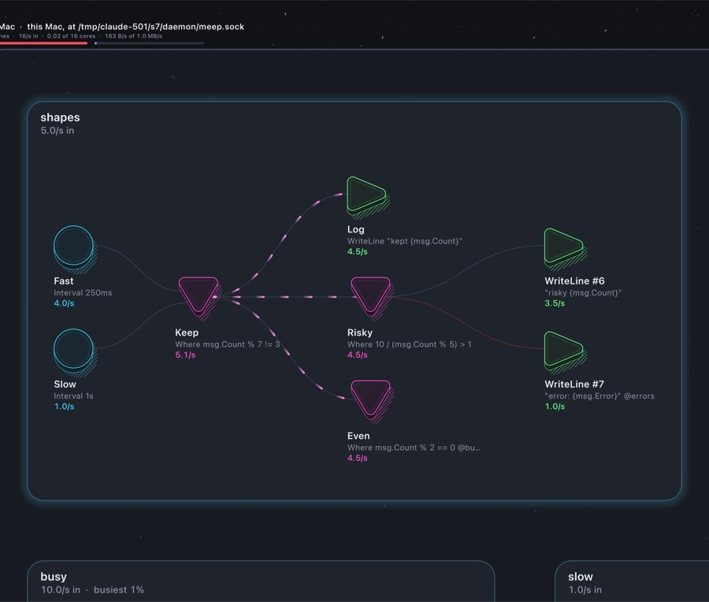
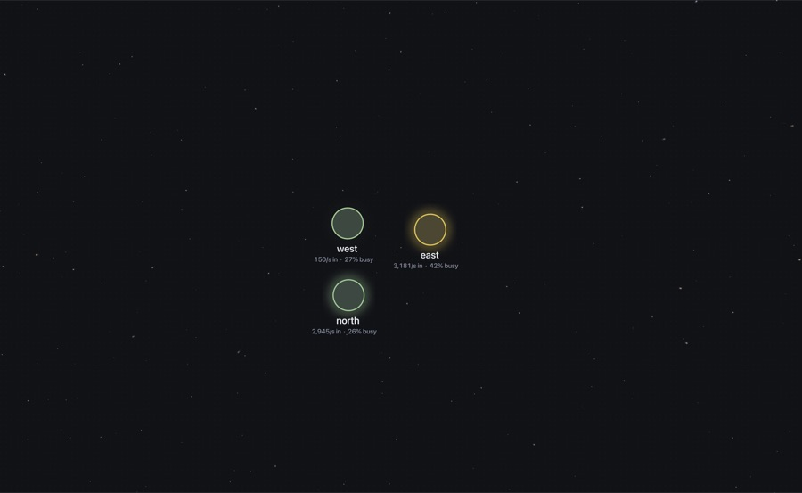

# Step 7: host and mesh

Written 20 November 2026. The seventh step of the order of work in [architecture-round-1.md](architecture-round-1.md), section 11: several daemons at once, remote ones reached through SSH, roll-ups and budgets, and one continuous zoom from a pipeline out to its host and the mesh of hosts (design, sections 2 to 4, Q1). It uses Meep2's prompt 5, in Meep2 0c83a49 on `main`: one subscription per connection, digests, and host identity and time. It needed nothing else from Meep2; prompt 6 (`meep run` joining a daemon) wasn't needed. Nothing is committed.

## What's built

- **One canvas for the whole Continuum** (`ContinuumStage`, in Stage), zooming like a map (Q1):
  - **The mesh:** each host is a plate, with its name, its roll-up and two meters above it. Further out, every host becomes a node together, coloured by how busy its cores are. Node labels are placed busiest first, and one that would touch another is left out (your note on labels piling up).
  - **A host:** its pipelines are districts on its plate, packed by size, each with its name and roll-up at the top. Zoomed out, a district shows its modules as blocks in their roles' colours; closer in, its tiles, wires and particles.
  - **A pipeline:** drawn by its own `PipelineStage`, in the same world and through the same camera. So nothing jumps between levels: the tiles a host shows small are the tiles you edit.
  - **Changes of scale are eased.** Moving from level to level eases, and so does the mesh when hosts or pipelines come and go, until you move the view yourself. A district that moves eases its tiles with it.
- **Levels and focus:**
  - **What the view settles on:** once the view stops moving, it settles on the pipeline or host that fills it, or the mesh. Thresholds are lower for what it's already on, so it doesn't flicker.
  - **Selection follows the view:** that focus becomes the sidebar's selection, and choosing something in the sidebar moves the view to it.
  - **Double-clicking** a host or pipeline zooms into it; the background shows every host.
  - **Above and below the canvas,** the header and dock follow the level:
    - The pipeline level keeps step 6's header, Meeplang pane and Modules and Probes dock. The modules table gains Busy and p50.
    - The host level shows the host's identity, its cores spare and its budget, over a table of its pipelines' roll-ups.
    - The mesh shows a table of the hosts.
- **Hover cards** for a pipeline's plate (its roll-up, busiest module, handling times and bytes) and for a host (cores, memory, connection, budget, clock), beside the tile and wire cards from step 2.
- **One subscription per host** (`HostSession`), in CBOR, through `HostLink.subscribe`:
  - **Detail follows the camera** (design, section 4):
    - A pipeline off screen gets its totals every 2 seconds.
    - On screen as a plate, every second.
    - With its tiles showing, its modules' and links' counts every half second.
    - In focus, every 200 ms, with handling times and bytes.
  - **Changed in place:** the plan is worked out again a few times a second, and only what moved is sent, as a merge patch.
  - **Updates are applied as they come:** a value replaces, null is gone, and a count that hasn't changed keeps its value. A missed update (a gap in `seq`) asks for everything again.
  - **Rates use the host's clock,** put onto this Mac's, so jitter in arriving doesn't wobble them.
  - **Older daemons:** a daemon from before Meep2 0c83a49 is still followed with step 1's stats streams.
- **Budgets:**
  - **A byte budget for each host's connection:**
    - **The defaults:** 1 MB/s for this Mac, 64 KB/s over SSH, 256 KB/s for the simulated host. Each can be changed in the host's header, and is kept.
    - **The planner** (`SubscriptionPlanner`, in FlowKit) estimates what its rates cost and slows everything down together to stay under four fifths of the budget. Each estimate is corrected by what the host says it really sent, and an update the host's budget held back (`held`) counts as being over.
    - **The daemon is told the budget too,** as Meep2's backstop.
  - **The machine's cores:** what its pipelines keep busy (from `busy`), what the daemon's process uses, and the machine's load, against its cores. This is "how much headroom each host has left" (design, section 4, "Load").
- **Roll-ups:**
  - **A pipeline's and a host's totals:** messages in from sources, messages through modules, cores, failures, waiting and bytes. They come from Meep2's totals, so a pipeline drawn as a dot costs almost nothing.
  - **Handling times:** histograms (`HandlingHistogram`) merged by adding buckets, from module to pipeline to host, giving p50 and p99.
  - **Load:** each module's load, from 0 to 1, colours its district from cool to hot.
- **Hosts on other machines,** reached through SSH (`SSHTunnelProvider`, in Transport):
  - **Finding the socket:** `ssh host meep daemon socket` gives the daemon's socket and ID.
  - **The forward:** `ssh -N -L` forwards it to a socket here that only you can open. The daemon sees its own user, so it gives every capability, as Meep2's report describes.
  - **A relay when the forward is refused:** where the host's sshd won't forward sockets, the tunnel relays through the SSH session with `nc -U` instead, and the host's header says so.
  - **ssh's problems in plain words:** no key, an unknown host key, meep not on a non-interactive `PATH`, forwarding refused.
  - **Each new connection makes a new tunnel,** and closing the connection closes it.
  - **Adding hosts:** Add Host… in the sidebar asks for the destination, port, socket, how to run meep there, other ssh options, and a budget. Hosts and budgets are kept in `~/Library/Application Support/Synesthesia/hosts.json` (`HostStore`).
- **Who a host is:** its lasting ID, names and addresses from `hello`, where its Listens are bound, and its clock offset, estimated from when updates arrive.
- **MCP tools:**
  - **`list_continuum`:** each host's ID, how it's reached, roll-up (cores, spare, clock) and connection (bytes against budget, slowdown), and the zoom level.
  - **`describe_view`:** the level, the focus, and each host and pipeline on screen, with where it's drawn, how, its roll-up, and the detail asked for.
  - **`capture_view`:** works at every level, and draws the canvas when the window is covered.
  - **`show`:** zooms to a host, a pipeline or a module, or the whole mesh with `meep://`.
  - **`describe_pipeline` and `watch_counts`:** for a pipeline shown only as a plate, they ask for its modules' counts and wait for them first.
- **`MeepClient`:**
  - **Contracts:** `SubscriptionPlan` and its merge patches; `hello`, updates, plans and problems.
  - **CBOR:** a reader that turns the daemon's CBOR frames into JSON.
  - **More from the daemon:** identity in `DaemonInfo`, and `graphVersion` in the list.
- **`SimulatedHost`** grew to match, so no test needs a daemon:
  - **The same subscription,** with rates on one grid, deltas, graph notices, a heartbeat, and a budget that holds updates back and says so.
  - **Plan changes take its latency,** as over a network.
  - **What a daemon reports:** an ID, a clock skew of your choosing, cores, handling times, bytes for network verbs, runtime metrics, and lost updates for testing.

## Tried in the app

Built with `scripts/build-app.sh`, against three hosts:

- **This Mac:** the test daemon running `busy`, `shapes` and `slow`.
- **Lab:** a second daemon with a `MEEP_HOME` of its own, running `ingest` (two timers merging, filters and errors) and `web` (a Listen answering a Fetch four times a second). It was reached through SSH to this Mac. Remote Login is off here, and turning it on is yours to do, so I ran a test sshd of my own on 127.0.0.1:2222, with a key made for it. Not running as root, it refused to forward the socket ("open failed"), so the tunnel relayed through the session with `nc`. `meep daemon socket` found the socket and ID first, with the meep command set to `MEEP_HOME=… /…/meep`.
- **The simulated host,** with its clock 1.2 s ahead.

Computer use was declined, so I drove the app with its own MCP tools. With `SYNESTHESIA_CAPTURES` set, the app saved its window each time (below).

- **The mesh (top):** all three hosts, with their roll-ups.
  - **This Mac:** 16 messages a second in, 0.01 of 16 cores, 0.6 to 1.7 KB/s of its 1 MB/s.
  - **Lab:** 41 a second, 1.3 to 2.2 KB/s of its 64 KB/s.
  - **Simulated:** about 3,300 a second, 2.6 of 8 cores, 3 to 5 KB/s of 256 KB/s.
- **`show meep://simulated`** eased to the host level and selected it (second picture). Its header showed 56% of 8 cores spare and the clock at +1.20 s, the skew it was made with; the dock listed its pipelines.
- **`show meep://simulated/warehouse`** and **`meep://local/shapes`** eased into the pipeline level. The Meeplang of `shapes` opened beside the canvas from the real `meep lsp`, and handling times arrived (p50 556 µs for warehouse, 49 µs for web).
- **Lab (below):** its header said it's reached through SSH and relayed, with its ID, 64 to 70% of 16 cores spare, and handling p50 49 µs, p99 2.6 ms.

## Found while trying it, and fixed

- **Tiles eased in from the wrong place** the first time a pipeline was placed, leaving districts empty for a moment. A pipeline is now put in its district at once the first time, and eased only when the hosts are packed again.
- **Rates spiked when a pipeline came back on screen:** Feed read 571 a second for a 40 ms Interval. An update already on its way when the plan changed didn't have the pipeline's modules, so their old counts were read as unchanged at a new time, and the next real counts looked like a burst. Counts are now read as unchanged only while they're being followed. A test reproduces it, through a simulated host whose plan changes take its latency, and fails without the fix.
- **The view didn't fit what it was showing** when the canvas changed size as the header or dock changed with the level. It now fits again until you move it.
- **Every host was meant to become a node at once:** at first, hosts of different sizes were drawn one as a plate and one as a node at the same zoom.
- **Headers covered the pipelines:**
  - A host's name and meters now sit above its plate.
  - A district's header has a plate behind it where it covers the top of the pipeline when zoomed out.
  - Up close, the header grows with the tiles, but only past 90%.
- **Small things:**
  - Off-screen pipelines' totals come every 2 seconds rather than 5, so the sidebar's rates appear sooner.
  - At the mesh zoom, the pointer finds plates rather than tiles too small to aim at.
  - A clock offset under 5 ms shows as 0.00 s.

## Tests

- **202 tests in 49 suites, all passing, three runs in a row,** with the live tests against the test daemon, the real `meep lsp` and the SSH tunnel to Lab; step 6 had 153.
- **Robustness found on the way:**
  - **The SSH relay could end the tests with SIGPIPE** when written to after ssh had gone. Pipes now return an error instead, and the app ignores SIGPIPE.
  - **A probe test could crash** by indexing a message that hadn't come. It now fails cleanly.
  - **A paused probe could take one more message** that was already on its way.
  - **The machine was heavily loaded by other programs** (a load average up to 35), so the test helpers' waits for readiness were raised to 20 seconds. They only bound how long a slow run waits.
- **New:**
  - **`MeepClientTests`:**
    - Fixtures captured from Meep2 0c83a49, made anonymous: `hello`, the first update whole, a later one with only what changed, a `plan`, and the same in CBOR.
    - RFC 8949's own CBOR examples, merge patches and plans.
    - Live: identity and clock; a subscription sending only what changed, in JSON and CBOR; a change in place bringing handling times.
  - **`FlowKitTests`:** histograms merging, quantiles and differences; rates falling when counts stop; the planner's rates, budget and correction.
  - **`ContinuumKitTests`:**
    - Identity, roll-ups and runtime arriving.
    - What's shown being what's asked for.
    - A tight budget slowing the plan.
    - A missed update asked for again.
    - The clock offset.
    - A failing tunnel saying why.
    - Headroom.
    - The host store.
    - Rates staying true when a pipeline is shown again.
    - Live: a daemon followed with one subscription, and a daemon reached through SSH (with `MEEP_TEST_SSH`).
  - **`StageTests`** (`ContinuumStage`):
    - Districts packed on their hosts' plates.
    - Showing setting the level and the detail asked for.
    - The view settling on what fills it.
    - The pointer finding tiles, plates and hosts.
    - Double-clicking zooming in.
    - Hosts becoming nodes together.
  - **`MetalStageTests`:** the Continuum drawn at every level (with `SYNESTHESIA_SNAPSHOTS`, saved as PNGs).
  - **MCP:** the view described at the mesh and host levels; `show meep://`; hosts listed with roll-ups and connections.

## Decisions made while building

- **A pipeline is drawn in the Continuum's world at its own size,** not scaled into its district. Its stage then only needs an origin and the shared camera; each level is the same drawing seen from further out, and gestures at the pipeline level go to its stage unchanged.
- **The mesh is packed in rows for now,** not the damped force layout in the design (section 7). With no flows between hosts yet, a force layout would have nothing to pull on. It comes with step 8's flows.
- **Hosts become nodes all at once,** by their average size on screen, so the mesh is drawn one way at a time.
- **Selection follows the view only once it settles,** and only after you've moved it. Moves made for you (the sidebar, `show`, a host appearing) don't select anything else on the way.
- **CBOR always,** since Meep2's CBOR is about half the size of its JSON, and the reader is small. Frames are turned into JSON and read by the same decoders, so both are tested by the same fixtures.
- **Budgets are estimated, then corrected,** rather than found by trial. The planner knows roughly what each thing costs; the host's `bytes` and `held` say how wrong it was. Meep2's own budget stays a backstop.
- **The relay with `nc`** is a fallback, not the way in. `ssh -L` is as the design and Meep2's report have it, and opens nothing on the host. But an sshd that won't forward sockets (hardened, or not root, as mine was) is common enough to deal with.
- **Times come from the host's clock.** Rates use the difference between the host's clocks, and the offset is taken where updates are read, off the main actor, as the largest of the last twenty. So a busy main actor doesn't make a host look behind.
- **A subscription's list is by name.** The daemon's list is a map, and keeping pipelines in name order keeps the sidebar steady.
- **`SYNESTHESIA_CAPTURES`** makes the app save its whole window when `capture_view` runs. It draws its views and puts the Metal canvas in where it is, so a step can be looked at without screen recording or computer use.

## Not checked

- **Gestures in the app:** pinching and scrolling between levels, double-clicking plates, dragging on districts and the hover cards. Computer use was declined, so the app was driven with `show`. `ContinuumStage`'s tests cover the same paths: zooming, settling, hit-testing and double-clicking.
- **`ssh -L` to a real sshd:** mine refused to forward, so Lab used the relay; the forward was tried up to the refusal each time. With Remote Login on (System Settings › General › Sharing), `localhost` would take the forward. That's yours to turn on.
- **Add Host…** and typing a budget in the host's header weren't used in the app. Adding hosts went through `hosts.json` (with `SYNESTHESIA_HOSTS`, so yours wasn't touched); the store and the budget's effect are tested.
- **The window at its usual size for the pipeline level:** your window was 1080 points wide when I took the last pictures, so the Meeplang pane left the canvas narrow, and the pipeline picture is the canvas alone.

## Not done yet

- **Flows between pipelines and hosts, and the boundary,** with the force layout they need: step 8, with Meep2's prompt 7.
- **History** (rings at a few resolutions, scrubbing back) and drawing slightly in the past (design, section 4).
- **A particle budget,** and drafts (pipelines in a workspace that run nowhere).
- **Accepting OTLP pushes** from hosts Synesthesia can't reach (Q5).
- **A possible Meep2 ask:** a `meep daemon` command that joins its standard input and output to the daemon's socket. The relay wouldn't then need `nc` on the host, and it would work on Windows. Not needed while `nc` is there.

## Next

**Step 8, the boundary and flows between hosts:** declared flows (Fetch and Send addresses matching a Listen) and observed ones, the boundary's endpoints round the mesh's edge, and the mesh's force layout. Meep2: flow evidence (prompt 7).
