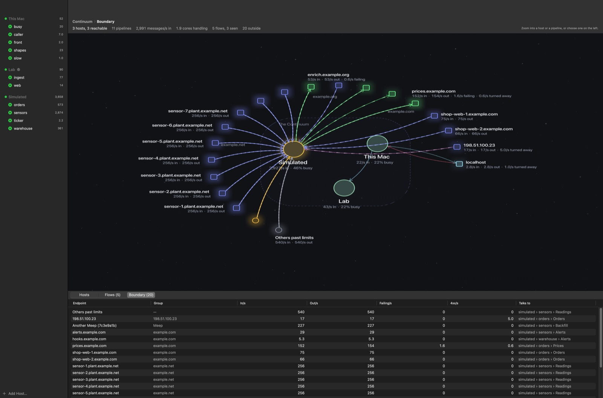
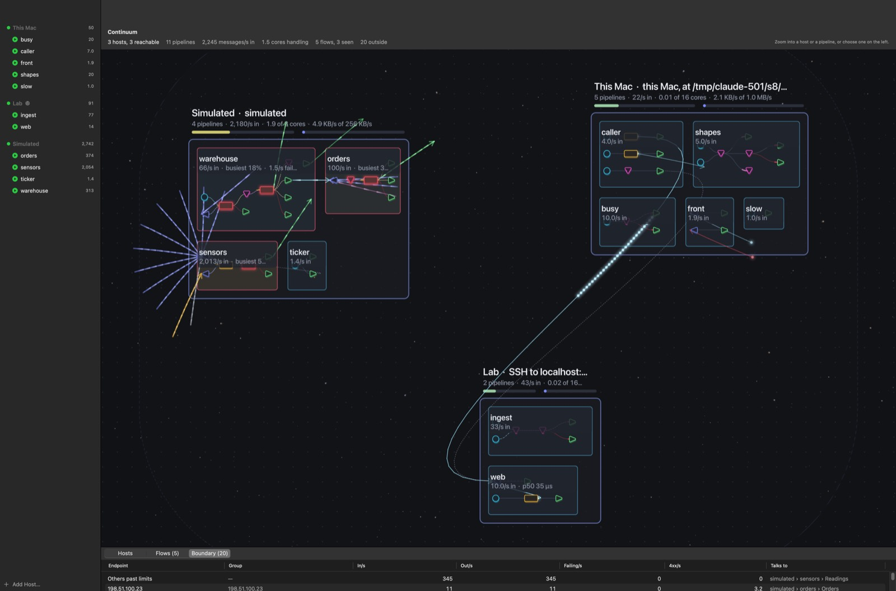
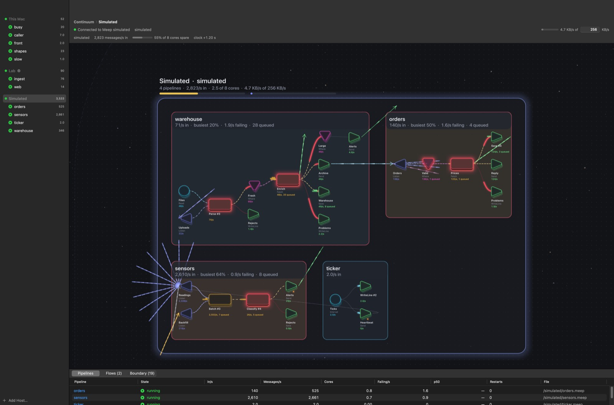
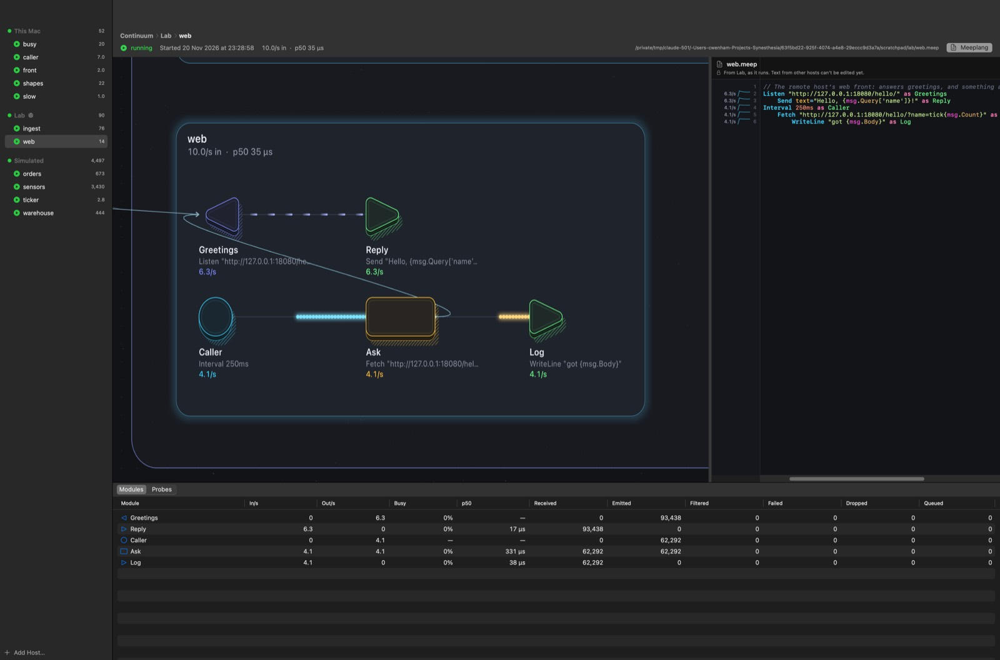

# Step 8: the boundary, and flows between hosts

Written 21 November 2026. The eighth step of the order of work in [architecture-round-1.md](architecture-round-1.md), section 11: flows between pipelines, on one host and across hosts, declared and observed; the mesh's damped force layout; and the boundary (level 6), with the endpoints outside Meep round the edge of the mesh (design, sections 2, 3 and 7). It uses Meep2's prompt 7, in Meep2 a5de139 on `main`: origins between Meep hosts, each Listen's arrivals, each Fetch's and Send's destinations with `peers`, clients' names, folding, `rejected`, and declared `sending`. It follows the report's "What a client has to do" as the contract, and needed nothing else from Meep2. Nothing is committed.

## What's built

- **Flows between pipelines** (`FlowMap`, in ContinuumKit), worked out from what the hosts send, without evaluating Meeplang (design, rule 2):
  - **Declared:** each `sends` entry with an `endpoint` is matched with the Listens on known hosts:
    - **The port and family:** the Listen's port, and HTTP or WebSocket against TCP.
    - **The host:** a loopback endpoint reaches Listens on the same machine as the sender; a name or address reaches a host that goes by it, at a Listen bound there or to every address.
    - **The path:** the Listen's path starts the Send's; for an address worked out for each message, as far as its first `{`. Of several Listens on one port, the longest path wins, as routing would choose.
  - **Observed:** an arrival keyed `meep://<ID>/<pipeline>/<key>` is a flow from that module; a destination in `peers` is a flow to that daemon, whose Listen the endpoint and declared address name. A destination not known as Meep that a known host's Listen is bound to (TCP, which carries no origin) is a flow seen by address.
  - **One flow from both ends:** the Listen's arrivals give its rate and replies; the sender adds failures the Listen never saw, such as refused connections. An observed flow confirms a declared one.
  - **Another Meep:** an origin or peer whose daemon Synesthesia doesn't follow, such as a `meep run`, is drawn on the boundary as another Meep.
- **The boundary:**
  - **Its endpoints:**
    - **Clients of Listens,** by their names from `clients`, or their addresses.
    - **What Fetches and Sends reach** outside Meep.
    - **Other Meeps.**
    - **Everything past a module's limit**, `*` and `meep://*`.
  - **Grouping:**
    - **By name:** two addresses with one name are one endpoint, known by both.
    - **By domain:** names are grouped by domain (`api.example.com` is in `example.com`, `shop.example.co.uk` in `example.co.uk`).
  - **What each shows:** its rate in and out, failures (5xx and no answer) and rejections (4xx). An endpoint known only from a declared address says so, and is drawn dashed.
  - **Folding:** a place folded into `*` has its last counts carried into `*`'s before `*` is read, so `*`'s rate doesn't jump (`CountSet.carry`, in FlowKit).
- **Drawing** (`ContinuumFlows.swift`, in Stage):
  - **Flows:** seen ones solid, with particles; declared ones dashed, with dashes that keep their length on screen.
    - **Width:** grows with the log of the rate.
    - **Colour:** turns toward red by the share failing or turned away.
    - **Direction:** an arrowhead at the Listen's end.
  - **At a host's or the mesh's distance:** between districts, from the side of the Send's tile to the Listen's. Between tiles, a flow is a cable: out of the Send's right side and into the Listen's left, as wires are. A Fetch asking its own pipeline's Listen shows once its tiles do.
  - **Further out:** with hosts drawn as nodes, the flows between each pair of hosts are added up into one line.
  - **Particles are honest:** worked out in points on screen, so they read at every zoom. One particle is one message below three a second, and a stream shows the rate above that, as on wires (design, section 4).
  - **The Continuum's edge:** a faint region round the mesh, clearer as the view draws back.
  - **Endpoints round the edge:**
    - **Markers:** a rounded square for outside Meep and a disc for another Meep. They're coloured by what meets them inside: periwinkle for clients of Listens, green for what Sends and Fetches reach, both when both, amber for another Meep and grey past limits.
    - **Labels:** each endpoint's label goes outward from the ring, placed by how busy it is, and left out where it would touch another (your note on labels piling up); hovering shows it. A domain with several endpoints is named once, inside them.
    - **Lines:** at the boundary, lines run from each endpoint to the hosts it talks to. Among plates, each Listen or Fetch has a short stub pointing the way to its endpoint, whole while the endpoint is hovered, so lines to the edge don't cross the mesh.
- **The mesh's damped force layout** (`ForceLayout`, in LayoutKit), now that flows give it something to pull on:
  - **The forces:** hosts push each other once within reach, a pull to the middle is stronger up and down so the mesh comes out wider than tall, and each pair of hosts with a flow between them is pulled side by side, seen flows harder than declared ones.
  - **When it moves:** it starts from where hosts were, so a new host or flow moves the rest as little as it can. It's deterministic, and boxes never overlap.
  - **Moves ease** over 0.8 s, ease-out, as plates did. The layout runs again only when which hosts talk to which changes, not as rates change.
- **The boundary's place round the edge** (`EdgeLayout`, in LayoutKit):
  - **Where each goes:** each endpoint wants the angle from the mesh's middle toward the pipelines it talks to.
  - **Groups:** a domain's endpoints are a run, side by side, centred where they'd like to be.
  - **Spacing:** runs are pushed apart, round the back too, and turned as a whole to sit nearest where the busiest want.
- **Level 6, the boundary:**
  - **When it's the level:** with nothing in focus, the level is the boundary while hosts are nodes and the mesh while they're plates, decided once the view settles, with a gap between so it doesn't flicker.
  - **Getting there:** fitting the mesh shows its hosts as plates; `showBoundary` draws back far enough that they're nodes.
  - **The breadcrumb** says Continuum › Boundary.
  - **The docks:**
    - **The mesh:** Hosts, Flows and Boundary tabs. Drawing back to the boundary shows its table, and coming in again, the hosts'.
    - **A host:** Pipelines, Flows and Boundary tabs, for that host.
  - **The mesh's header** counts flows, those seen, and endpoints outside.
  - **Hover cards:** for a flow, the flows between two hosts, and an endpoint, with each module that talks to it.
  - **Double-clicking** a flow shows both its ends; an endpoint, it and what it talks to.
- **The planner** asks for `arrivals` and `destinations` only for what's on screen, at the design's refresh for each level (section 2):
  - **Every second** for a pipeline whose tiles show.
  - **Every 2 seconds** for a district.
  - **Every 5 seconds** inside a host drawn as a node.
  - **Never** off screen.
  - **What it asks of:** only pipelines with Listens, Fetches or Sends (from `listens` and `sends`), with their cost in the estimate, slowed down with the rest to stay in budget.
  - **Counts no longer followed** keep their last values but have no rates, so nothing off screen is drawn as live.
- **`SimulatedHost`** grew to match, so no test needs a daemon:
  - **What it says:** declared `sending` and `sends`, each Listen's arrivals from clients it's given (addresses with names, origins from other Meep hosts, `*`), each Fetch's and Send's destinations, `peers`, `clients`, and folding on demand, named in `folded`.
  - **The demo host:**
    - **Flows:** one between its own districts (warehouse's Archive into orders) and one declared but never sent (the ticker's Heartbeat).
    - **Outside:** shop and partner clients, sensors with clients past the limit, APIs it fetches from and sends to, and another Meep.
- **MCP tools:**
  - **`list_continuum`:** every flow (its ends, how it's known, rates) and the boundary (each endpoint, its group, rates and the modules that talk to it).
  - **`describe_view`:** the flows and endpoints on screen, how each is drawn, and the level, now including `boundary`.
  - **`describe_pipeline`:** each Listen's arrivals and each Fetch's and Send's destinations, with names, which are Meep, and rates, and the pipeline's flows and boundary. It asks for them while it describes, and waits for them.
  - **`show boundary`:** draws back to the boundary; `show mesh` comes back in, from the boundary too.
- **`MeepClient`:** `SendAddress`, `sending` in `GET /`, `sends` in the host's updates, the places' count order in `hello`, and `arrivals`, `destinations`, `clients`, `peers` and `folded` in each pipeline's part.

## Tried in the app

Built with `scripts/build-app.sh`, against three hosts:

- **This Mac:** a test daemon running `busy`, `shapes` and `slow`, and two new pipelines:
  - **`caller`:** a Fetch to Lab's Listen twice a second, a Fetch to an API outside Meep (a Python web server on `localhost:18090`), and a Send declared but never sent.
  - **`front`:** Listens for a client outside Meep, a `curl` loop, whose `/old/` answers 404.
- **Lab:** a second daemon running `web` (a Listen, and a Fetch to it four times a second) and `ingest`. It was reached through SSH to a loopback test sshd on 127.0.0.1:2222, relayed with `nc` as in step 7.
- **The simulated host,** with the demo's flows and boundary.

The app was driven with its own MCP tools, and `SYNESTHESIA_CAPTURES` saved its window each time.

- **Declared before observed:** as soon as the hosts connected, `list_continuum` had the declared flows:
  - This Mac's `caller › AskLab` to Lab's `web › Greetings`, across hosts, matched by loopback on one machine, port and path.
  - `caller › Unused` to the same Listen.
  - Lab's `web › Ask` to its own Listen.
- **Observed once drawn:** with the canvas drawing, each district's places came every second or two, and `describe_pipeline meep://local/caller` said `AskLab` was "declared and observed", 2 a second, its destination `127.0.0.1:18080` named as Lab's.
- **The boundary** (top): 20 endpoints and 5 flows, 3 of them seen.
  - **`localhost`** is two things: the `curl` client and the Python API, so it's drawn both ways. It showed 1 a second turned away, the 404s from `/old/`.
  - **The simulated sensors** are grouped as `example.net`, with "Others past limits" for the clients beyond them, and "Another Meep" for an origin from a daemon nobody follows.
- **The mesh** (second picture): flows between districts with particles, and stubs pointing the way to the boundary.
- **A host** (third picture): the simulated host's districts, warehouse's Archive into orders, and the ticker's declared Heartbeat, dashed.
- **A pipeline** (last picture): Lab's `web`, with This Mac's flow arriving at its Listen from the left, and its own Fetch looping round to it.

## Found while trying it, and fixed

- **Lines to the boundary crossed the mesh.** Among plates, each Listen's and Fetch's lines ran all the way to the ring, across other hosts. They're now short stubs pointing the way there, whole only at the boundary or while their endpoint is hovered.
- **The boundary's layout:**
  - **Groups interleaved:** endpoints of one domain were spread round the ring. Groups are now runs, side by side.
  - **The last run ran into the first** round the back, so markers sat on top of each other. Runs are now pushed back as well as on, until they fit. A test reproduces it, and fails without the fix.
- **Fitting the mesh made hosts nodes:** the view fitted the ring as well, so hosts were caught halfway between plates and nodes. The mesh now fits its hosts, and the boundary is further out.
- **Labels along the top were all hidden:** each ran into the next marker. Endpoints at the top and bottom now put their labels above or below.
- **A flow within a pipeline ran under its own tile.** Flows between tiles are now cables, out of a Send's right side and into a Listen's left.
- **"0/s failing":** rates under 0.05 a second no longer show in an endpoint's line.
- **`show mesh` from the boundary did nothing:** with nothing selected already, selecting nothing changed nothing. The tool now tells the canvas itself. A test catches it, now that the tests' viewer moves the canvas only when the selection changes, as the app does.
- **`show boundary` was lost at start-up,** before the canvas had a size. It now waits for one, as `show` does.
- **The full suite starved the main actor:** `flowMap()` takes 6 to 9 ms in a debug build, and the new tests asked for it every 10 ms. Now:
  - **Tests** poll for flows a few times a second.
  - **The docks and header** read the canvas's map, worked out four times a second, instead of working it out on every update.
  - **The stage tests' frame loops** sleep briefly rather than yield, so work of any priority gets the main actor.
  - **The simulated host's tick** works out each pipeline's counts once, and places only when asked for.
  - **`describe_pipeline`'s test** waits for places itself. A 7 s stall of the cooperative pool while the rendering suites run together could outlast the tool's own 5 s wait.
- **A step 2 test failed once in four runs:** the layered layout's "same each time" check differed in the last digit of a height, from unions chained in dictionary order. Bounds now come from exact least and greatest edges.

## Found in Meep2, not fixed

- **A second daemon removes the running one's socket.** `meep daemon <files>` in a folder whose daemon is running says "A meep daemon is running already", and on its way out removes that daemon's socket. The first keeps running, but can't be reached: `meep daemon socket` says none is running, and `meep daemon stop` can't stop it. I hit it by mistyping `meep daemon status`, which read `status` as a file. Reproduced with a fresh folder. It's in [meep2-prompts.md](meep2-prompts.md) as a short prompt, not needed by this step.

## Tests

- **248 tests in 58 suites, all passing, three runs in a row,** with the live tests against both test daemons, the real `meep lsp` and the SSH tunnel to Lab; step 7 had 202 in 49.
- **New:**
  - **`MeepClientTests`:**
    - Fixtures captured from the two daemons at a5de139, made anonymous: `GET /` with `sending`; `hello` with the places' order; the first update whole and a later one; Lab's first update with origins; and the same in CBOR.
    - Folding as the report gives it, and plans with arrivals and destinations.
    - Live: a Fetch's destination names the daemon it reaches, and that daemon's Listen names the Fetch by origin (with `MEEP_TEST_FLOW_SOCKET`).
  - **`FlowKitTests`:** places at 5, 2 and 1 seconds by distance, none for pipelines that count none, and their cost slowing the plan.
  - **`ContinuumKitTests`:**
    - Addresses, endpoints and domains read.
    - Declared addresses matched by port, host, machine, path and family.
    - One flow from both ends, confirmed by its declaration; declared only; resolved from the sender alone; seen by address over TCP.
    - Another Meep, and what's past limits.
    - Endpoints grouped by name and domain.
    - Folding without a jump.
    - Places no longer followed having no rates.
    - Two simulated hosts: an observed flow and the boundary, places asked for only while shown, and a folded client.
    - Live: an observed flow between two real daemons, declared too.
  - **`LayoutKitTests`:**
    - The force layout: no overlaps, flows pulling hosts together, the same each time, little movement for a new host, wider than tall.
    - The edge layout: endpoints outside the mesh, groups together, spacing, and runs meeting round the back.
  - **`StageTests`:**
    - Flows drawn solid when seen and dashed when declared, between their districts.
    - The mesh eased, not jumped, as flows pull it.
    - The boundary outside the mesh, found by the pointer, with a flow's line.
    - Drawing back to the boundary: nodes, flows between hosts, the Continuum's edge, and places asked for at each distance.
  - **`MetalStageTests`:** flows and the boundary drawn at the mesh, the boundary and a host (with `SYNESTHESIA_SNAPSHOTS`, saved as PNGs).
  - **MCP:** flows and the boundary listed; a pipeline's places and flows described, after asking for them; the view describing flows and the boundary on screen; `show boundary` and back.

## Decisions made while building

- **Matching is the client's,** as the report's contract says, and it's by rules Meep2 already states: endpoints as `host:port` in lower case, with 80 or 443 for web addresses. Loopback means the sender's own machine, which two daemons on one Mac share, so This Mac's Fetch to `127.0.0.1:18080` reaches Lab's Listen there.
- **A flow is keyed by its two modules.** The Listen's arrivals give its rate when both ends are followed; the sender's destination gives it otherwise.
- **Endpoints are merged by name, then grouped by domain.** A client's address with a reverse-DNS name, and a destination at that name, are one endpoint, known by both. Addresses without names are their own group.
- **What isn't followed isn't drawn as live.** Places keep their counts when they stop being asked for, so an endpoint doesn't vanish when you zoom in, but their rates are taken as zero, and no particles are drawn for them.
- **The force layout pulls by which hosts talk, not how much,** so a busy flow doesn't move the mesh each time its rate changes. Hosts become nodes and plates as before.
- **Level 6 is decided by zoom, not focus:** with nothing in focus, it's the boundary when hosts are nodes. So zooming out far enough gets there, as on a map, and `show boundary` is a shortcut to the same place.
- **Stubs among plates, lines at the boundary.** At the mesh's distance, what crosses to the outside is shown as direction and rate at its module; where the boundary is, it's shown whole.
- **Particles on flows are worked out in points on screen,** not world units, so a flow between hosts far apart reads the same as one between districts.
- **Docks read the canvas's flow map,** worked out four times a second, rather than their own.
- **Flows between tiles are cables,** like wires, rather than curves bowing to one side, so they leave and arrive at the sides the tiles' shapes point to.

## Not checked

- **Gestures in the app:**
  - **What wasn't done by hand:** hovering a flow or an endpoint for its card, double-clicking them, and pinching out to the boundary.
  - **Why:** computer use was declined in step 7, so the app was driven with `show`, and `ContinuumStage`'s tests cover hit-testing and the level following the zoom.
- **Easing and particles moving live:** the app's window was mostly behind others, so the pictures were drawn by `capture_view`, one frame each. An endpoint that moved was drawn at the start of its ease until the next capture.
- **WebSocket flows, and TCP between real daemons:** the test pipelines use HTTP. TCP flows by address are tested with modelled hosts.
- **Folding on a real daemon:** it needs more than 64 clients and ten quiet minutes. It's tested with the simulated host and the report's example.
- **`ssh -L` to a real sshd:** still relayed, as in step 7.

## Not done yet

- **Sampled traces** for tracers (Q219): a Meep2 prompt of its own, starting from the design in its report.
- **Round-trip times on links between hosts** (design, section 4): Meep2 doesn't measure them yet.
- **History** (rings at a few resolutions, scrubbing back) and drawing slightly in the past.
- **A particle budget,** drafts, and accepting OTLP pushes.
- **Pinning hosts** in the mesh's layout.

## Next

**Step 9, the Claude sidebar:** the tools written once in `Assistant`, offered in the app through the Claude API, with focus and selection as addresses.
