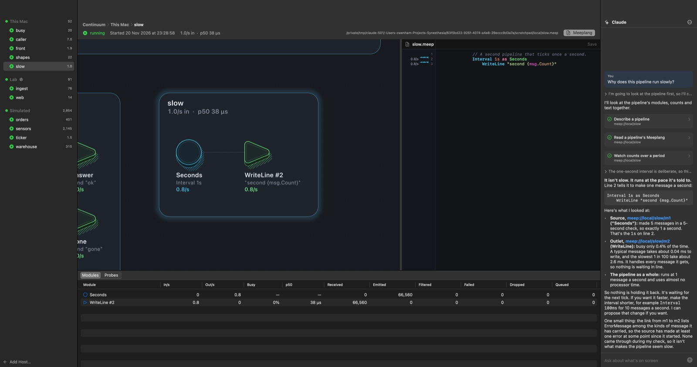
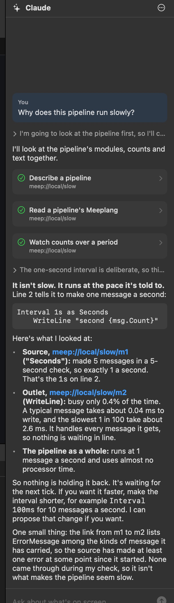

# Step 9: the Claude sidebar

Written 21 November 2026. The ninth step of the order of work in [architecture-round-1.md](architecture-round-1.md), section 11: Claude inside the app, using the tools written once in `Assistant` that the MCP server already offers, and talking to the Claude API directly over HTTPS with your own key, which also works on the iPad (design, section 8; Q8). It needed nothing from Meep2. Nothing is committed.

The API's shapes come from Anthropic's documentation of the Messages API, read for this step: the request, streaming, tool use with input that streams in, thinking, prompt caching, refusals and fallbacks, and errors. Swift has no Anthropic SDK, so the client is written here, as the MCP protocol was in step 3.

## What's built

- **A client of the Messages API** (`ClaudeAPI`, in `Assistant`):
  - **One streamed request a turn:** `POST /v1/messages` with `anthropic-version: 2026-10-21`, model `claude-opus-5-5`, and room for 64,000 tokens, since thinking counts toward them.
  - **Thinking:** adaptive, the only kind this model takes, with its summaries shown (`display: "summarized"`). Effort is always said: medium unless you choose otherwise in Settings or the sidebar's menu.
  - **Streaming:**
    - **Events** are read from bytes as they arrive, in chunks that can end anywhere, even inside a character (`SSEParser`).
    - **The reply** is built from them block by block (`ClaudeReply`): text, thinking with its signature, tool calls with their input arriving as pieces of JSON, a switch to a fallback model, and anything else kept as it came.
    - **Unknown events and deltas,** and pings, are ignored, as the API's versioning asks.
  - **HTTPS** through an ephemeral `URLSession`, so nothing of a conversation is cached on disk. Stopping cancels the request.
  - **Caching:**
    - **The system prompt and the tools** are the same for every request, and come first, with a cache breakpoint on the system prompt.
    - **The conversation so far** is cached by the request's top-level `cache_control`.
    - **Nothing changes in the prompt** between requests, such as a date; what changes goes in the questions.
  - **Refusals:** `fallbacks: "default"` (beta `server-side-fallback-2026-07-01`). When Anthropic's safety classifiers decline a request, the model Anthropic recommends for that kind of refusal answers instead, on the same stream.
  - **Thinking kept valid:** `prefix_mismatch_behavior: "drop_block"` (beta `thinking-binding-controls-2026-08-01`). The API checks that the conversation before each thinking block hasn't changed; the transcript is append-only so it never does, but if it ever did, the block would be dropped rather than the request failing.
- **The tool loop** (`ClaudeChat`, in `Assistant`):
  - **The same tools:** each tool's `apiDefinition` is its name, description and schema, the same as MCP's `tools/list`, from the same `ToolRegistry`. The app makes one registry and gives it to both.
  - **Input checked before it runs** (`SchemaCheck`): input streams in without the API checking it (`eager_input_streaming`), so it can be cut short or not match.
    - **Not JSON:** the call isn't run; Claude gets an error result with what it sent.
    - **Not matching the schema:** the same, with what was wrong and where, such as `input.seconds is 60, above its most, 30`.
  - **How a reply ends:**
    - **Tool calls:** each is run in turn and every one gets a result, in one message, then the loop goes on.
    - **`end_turn`:** the turn is over.
    - **`max_tokens`:** what was written stays; tool calls aren't run, since their input may be cut short, but they're answered so the conversation can go on.
    - **`refusal`:** what came before it is taken away, as incomplete, and so is the question; the sidebar says Claude declined, with the category and explanation the API gives.
    - **`model_context_window_exceeded`:** the sidebar says to start a new conversation.
  - **After a fallback:** what the declining model wrote before the switch goes back as text only, with the switch where it was, as the API asks; only the calls after the switch are run.
  - **Tried again on its own,** twice, after a rate limit that says how long to wait, an overload, a server error, a dropped connection or a stream that ends early. What the failed attempt showed is taken away first.
  - **Stop:**
    - **While Claude writes:** what it wrote so far stays, and the next question tells Claude it was stopped.
    - **While a tool runs or waits for you:** the call is answered as stopped.
  - **A limit:** 40 requests for one question.
  - **The transcript only grows.** The one exception is an unanswered message at its end, which the next question joins, or which a refusal takes away. Roles always alternate.
  - **Images** from `capture_view` go to the API scaled so their longest side is 1,568 pixels, as large as the model reads; the sidebar shows them as they were.
- **Safety** (design, section 8):
  - **Tools beyond looking are asked about first.** `Tool.asks` says which:
    - **`propose_edits` and `inject_message`:** Claude asks before either runs. If you allow it, you still decide in the app: the proposal shows as ghost tiles and a diff, and the message opens in the composer, as over MCP.
    - **`sample_tap`:** the first tap in a conversation says that the messages it reads are real contents, sent to Anthropic's API.
  - **Allow, Don't Allow, or Allow in This Conversation,** which lasts until the conversation starts over.
  - **`show` isn't asked about,** since it changes only what the app shows.
  - **Waiting for you:** a tool that's waiting opens the sidebar if it was closed.
- **Context:** each question goes with the app's note of what you're looking at (`SidebarPrompt.context`):
  - **The canvas:** its level and what it's on, such as `The canvas is on a pipeline: meep://local/orders.`
  - **What's selected:** in the list of hosts, and tiles on the canvas, as addresses with their labels.
  - **The text:** whether the Meeplang is open beside the canvas, with changes not saved.
  - The system prompt tells Claude that "this", "here" and "it" mean those, and that the note is the app's, not yours.
- **The key** (`ClaudeKey`, `KeychainStore`):
  - **Kept in your Keychain,** as a generic password, entered by you in Settings.
  - **Read once,** when a request first needs it, then held in memory; it goes only in the request's header. Settings says whether one is saved without reading it.
  - **A refused key** is forgotten from memory, so a new one is read next time.
- **The sidebar** (`ClaudeSidebar`, in `SynesthesiaUI`, so the iPad gets it too):
  - **Where:** an inspector at the window's right, opened with the toolbar's Claude button or View › Show Claude (⌥⌘C). Its edge can be dragged.
  - **Replies stream in** as Markdown, aligned left: paragraphs, lists, headings, code and quotes. Code scrolls sideways only when it's too wide.
  - **Addresses are links:** every `meep://` address in a reply, in code too, is a link that shows the place with the same `show` tool Claude uses.
  - **Thinking:** each summary is folded to its first line, and unfolds.
  - **Each tool call as it runs:** its title and the address it's about as soon as the input names it, a spinner while it's written and run, then a tick, a warning or why it didn't run. Unfolded, it shows its input and its result, pictures included.
  - **Notices** for a refusal, a limit, a problem or a stop, each with what to do: Open Settings, Try Again or New Conversation.
  - **The status line:** asking, thinking, writing, getting a tool ready, running it, waiting for you, or trying again in so many seconds and why.
  - **The composer:** Return asks; a stop button replaces the send button while Claude works (⌘.).
  - **The menu:** New Conversation, Effort, Claude Settings, and the conversation's tokens so far, with the share read from the cache.
  - **Before the first question:** what the sidebar is for, examples, and what it sends where.
- **Errors, said plainly with what to do:**
  - **No key:** add it in Settings, under Claude.
  - **A refused key (401):** check it in Settings, or make a new one in the Claude Console.
  - **No permission (403), billing (402), the model not available (404),** each with where to look in the Console.
  - **A conversation too large (413), a request refused (400):** start a new one.
  - **A rate limit:** tried again on its own when the API says how long to wait; otherwise, or for a spend limit, said, with Try Again.
  - **Overloaded or a server error, or no connection:** tried again, then Try Again.
  - The API's own message and the request's ID are shown where they help.
- **Settings:** a Claude tab beside Canvas, with the key (saved, replaced or removed), a link to the Claude Console, and effort.
- **The app:** one `AppViewer` and one registry for MCP and the sidebar. The sidebar's being open is kept between runs, as the text's is.

## Tried in the app

Built with `scripts/build-app.sh` and opened on step 8's test setup: two daemons, the SSH host and the simulated host, with the sidebar open.

- **You saved your key** in Settings, under Claude, which then said a key was saved.
- **The window went blank around the sidebar:** you found the hosts list, the canvas's header and the docks blank while the sidebar was open, back when it was closed. Fixed (below). With the fix, the window draws whole with the sidebar open, as `capture_view` and `SYNESTHESIA_CAPTURES` showed.
- **You asked** "Why does this pipeline run slowly?" with `slow` in focus, and it worked (picture below):
  - **The note:** Claude took "this pipeline" to be `slow` from the app's note.
  - **The tools:** it described the pipeline, read its Meeplang and watched its counts for five seconds, each shown with a tick as it finished.
  - **The answer:** nothing is slow; the Interval makes one message a second, as line 2 says. It showed the line, suggested `Interval 100ms` and offered to propose it.
- **It named modules by their keys:** "the link from m1 to m2", and `meep://local/slow/m1 ("Seconds")`, which you found hard to follow. Fixed (below).

## Decisions made while building

- **One set of tools, two ways in, for real:** the sidebar sends `ToolRegistry`'s tools as they are. Nothing about them is written twice; `Tool` gained `asks` and `apiDefinition`, and MCP's `definition` is unchanged.
- **Asked in the sidebar first, then decided in the app.** Section 8 says tools beyond observing are confirmed unless allowed for the session. Proposals and offered messages were already the person's to accept or send; the sidebar now asks before Claude may even offer one. MCP is unchanged.
- **A session is a conversation.** "Allow in This Conversation" lasts until New Conversation, so what was allowed doesn't carry into an unrelated one.
- **The first tap asks rather than only saying.** Saying after the fact would be too late: the messages would be gone. It asks once a conversation, or each time if you allow only once.
- **Summaries of thinking, not just progress notes.** `display: "updates"` would show only Claude's notes between tool calls, but it's a beta, and a fallback model must accept the request as it is. Summaries need no beta and show more; they're folded so they don't crowd the replies.
- **Fallbacks on by default,** as Anthropic recommends for this model: a false positive from a safety classifier is answered by another model rather than stopping the conversation. The switch is shown.
- **The app's note goes in the question,** as a first text block in square brackets, rather than as a mid-conversation system message, which has placement rules a tool loop can trip over. The system prompt says whose it is.
- **Input is checked more strictly than over MCP.** MCP's tools clamp numbers into range; here input outside a schema's range isn't run, and Claude is told the range, as the API's guidance for streamed input asks.
- **A declined question is taken away** from what's sent next time, so it isn't declined again with the next question; it stays on screen with the notice.
- **The fixtures are made, not recorded.** Recording needs your key. They follow the documented shapes of each event, and `LiveClaudeTests` can record real streams into a folder with `CLAUDE_RECORD_FIXTURES`, to check them against.
- **Markdown is read here,** a block at a time, since SwiftUI's `Text` reads only inline Markdown. A reply still streaming in can end inside a code block and still read.
- **The Keychain item is a generic password in the login keychain.** The data-protection keychain needs a signing team and entitlements that the ad-hoc signed build doesn't have.

## Tests

- **291 tests in 65 suites;** step 8 had 248 in 58. The live tests against the Claude API were skipped: they need `ANTHROPIC_API_KEY`.
  - **Before the fix for the blank window,** 288 passed three runs in a row, with the live tests against both test daemons, the real `meep lsp` and the SSH tunnel.
  - **After it,** the sidebar's and MCP's suites pass (47 tests), but the full suite hasn't passed again. Full runs failed, with waits timing out across suites this step didn't touch, taking 55 to 480 seconds rather than 18. The Mac was busy (Rider and MSBuild and a Meep2 test run, a load average up to 79, and the app's canvas on screen at 120 frames a second), and then throttled by heat: `pmset -g therm` gave a CPU speed limit of 45%. The new tests' simulated hosts now send counts only when asked (`TestViewer(slowly: true)`), which is all they need, to add less to the full suite. The Mac didn't cool enough to try again before this was committed.
- **New:**
  - **`AssistantTests`:**
    - **A fake transport** (`FakeAPI`) replays SSE fixtures in odd-sized chunks, HTTP errors and dropped connections, and keeps each request.
    - **Fixtures** (`Tests/AssistantTests/Fixtures`, written by `scripts/make-claude-fixtures.py`): an answer with thinking; a tool loop over three turns; input that isn't JSON; input that fails its schema; a refusal; `max_tokens` during a tool call; an overload in the middle of a stream; a fallback before any output and one in the middle; calls that need asking; a tool that waits; a stream that ends early; a picture.
    - **The loop:** a question answered as it streams; the request's shape (model, thinking, effort, betas, caching, fallbacks, the same tools as MCP's with input streaming); the same request byte for byte each time; three turns with the real tools against a simulated host, each request's messages beginning with the last one's unchanged; tool input shown as it streams.
    - **Checking input:** not JSON, and against the schema, neither run; every real tool's schema accepting what its description suggests.
    - **Safety:** changes asked about, refused, allowed once and for the conversation, and forgotten on starting over; the real tools' `asks`, and what each asks; the first tap saying where messages go.
    - **Stop reasons:** a refusal withdrawn with its question; `max_tokens` running no tools, with the next question joining their answers; a fallback in the middle, sending back only what the API allows and running only the call after the switch; a fallback before any output.
    - **Errors:** 401, 400, 402 and 413 each with what to do; a rate limit and an overload tried again; a spend limit not; an overload in the stream tried again without its half reply; a dropped connection tried again, reported, then tried again by hand; a stream that ends early.
    - **Stopping:** while writing, keeping what was written; while a tool runs; while asking.
    - **Context:** the focus and selection as addresses; a link showing its address with `show`; modules and links named as the canvas names them.
    - **The parser, the schema check and the reply:** events in chunks of 1 to 1000 bytes with CRLF, comments and multi-line data; each problem saying where; empty text left out and thinking sent back signed.
    - **Live** (`LiveClaudeTests`, only with `ANTHROPIC_API_KEY`): a question answered with the tools against a simulated host, then a second read from the cache.
  - **`SynesthesiaUITests`:** Markdown's blocks; addresses linked, in code too; a label linked to its address reading as the label; the sidebar, a conversation and an approval never needing more height than a window has; the conversation, an approval and a notice drawn off screen (with `SYNESTHESIA_SNAPSHOTS`, saved as PNGs).

## Found while building, and fixed

- **Claude named modules by their keys** (your report). The system prompt now asks for modules by their labels on the canvas, links by their ends (Seconds → WriteLine #2), and hosts and pipelines by their titles and names. To point at one, Claude makes its name a link to its address, so a reply reads "[Seconds]" and still shows the place when clicked. `describe_pipeline` now names each link by its ends' labels too (`named`), for the sidebar and MCP alike.
- **The sidebar blanked the rest of the window** (your report). Text in the sidebar's empty state was held to its whole height outside a scroll view. At the narrow widths SwiftUI tries when sizing a window, that's a word to a line, over 6,000 points, so the window's content grew far taller than the window, and everything but the middle of the canvas was pushed out of sight. The approval card had the same flaw. The empty state now scrolls like the conversation, and nothing outside a scroll view is held to its whole height. A test measures the sidebar's least height at narrow widths, and fails without the fix.
- **Saving a key brought a scroll bar** to Settings (your report): the Claude tab fitted its content until the "key saved" row appeared. It's now tall enough for that row and a problem line.

- **The full suite timed out every streaming test:** they passed alone. Each chunk the fake transport sent was a trip to the main actor and back, and the full suite keeps the main actor busy. Chunks are now 61 bytes, not 7, and the parser's own tests split streams byte by byte.
- **Starting over while Claude was working** let the stopped turn write into the new conversation. It now clears once the turn has stopped.
- **A paragraph after a list joined its last item,** and short code sat in a scroll view. Lines continue an item only without a gap between, and code scrolls only when it's too wide.

## Not checked

- **The full suite since the fix for the blank window:** see Tests. It needs three runs in a row on a Mac that isn't throttled.
- **The live tests** against the Claude API haven't run: they need your key in `ANTHROPIC_API_KEY`. The app's one conversation used the real API, but approvals, a refusal, a fallback and the API's errors have been seen only against the fake transport.
- **Labels in replies:** the prompt asking for them was rebuilt into the app after your conversation, so no reply has used them yet.
- **The buttons in the off-screen pictures:** SwiftUI's `ImageRenderer` can't draw buttons, so the pictures show placeholders where they are.

## Not done yet

- **The iPad's way into Settings** is a sheet from the sidebar; it waits for the iPad app (step 11).
- **Conversations aren't kept** between runs of the app.
- **Compaction:** a conversation that grows past what the model reads ends with a notice to start a new one.

## Next

**Step 10, the code level:** C# source from the verb catalogue, opening in your editor.
